# BÁO CÁO KẾT QUẢ THỰC HÀNH LAB 07
**Học phần:** COMP1019 - Lập trình trên Windows  
**Đề tài:** SDI, MDI và Xây dựng ứng dụng quản lý cửa hàng mini nhiều Form (ShopManagerMini)  
**Sinh viên thực hiện:** Đặng Hoàng Bảo Huy | **MSSV:** 51.01.104.033 | **Lớp:** 51.01.CNTT.C  

---

## 1. Giao diện Đăng nhập khi khởi tạo (FrmLogin - SDI Modal)

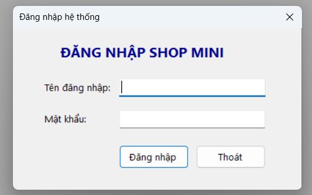

- **Mô tả:** Khi ứng dụng **ShopManagerMini** khởi chạy từ điểm nhập cảnh `Program.cs`, Form đăng nhập `FrmLogin` được kích hoạt đầu tiên dưới dạng cửa sổ đơn lập (SDI modal) thông qua lệnh `ShowDialog()`:
- **Tính năng & Thiết lập mặc định:**
  - Tiêu đề Form: `Đăng nhập hệ thống`, tự động căn giữa màn hình (`StartPosition = CenterScreen`).
  - Viền hộp thoại chuẩn (`FormBorderStyle = FixedDialog`), vô hiệu hóa nút phóng to/thu nhỏ (`MaximizeBox = false`, `MinimizeBox = false`) để giữ tính trang nhã cho giao diện đăng nhập.
  - Hộp nhập mật khẩu bảo mật: `txtPassword` kích hoạt thuộc tính `UseSystemPasswordChar = true` che dấu ký tự nhập dưới dạng dấu chấm bảo mật hệ thống.
  - Phím điều hướng nhanh chuẩn Windows:
    - Gán `AcceptButton = btnLogin`: Người dùng có thể nhấn phím `Enter` bất cứ lúc nào để đăng nhập ngay.
    - Gán `CancelButton = btnExit`: Người dùng có thể nhấn phím `Esc` để hủy bỏ và thoát ứng dụng.
  - Hệ thống tài khoản mẫu được khởi tạo sẵn trong bộ nhớ (`DataStore.Users`):
    - `admin` / `123`: Quản trị viên (Vai trò: `Admin`).
    - `user` / `123`: Nhân viên bán hàng (Vai trò: `User`).

---

## 2. Kiểm tra dữ liệu đầu vào & Bắt lỗi đăng nhập (Validation)

| Cảnh báo để trống tên đăng nhập / mật khẩu | Báo lỗi thông tin tài khoản không chính xác |
| :---: | :---: |
| 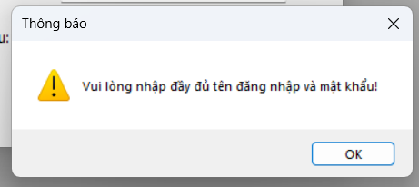 | 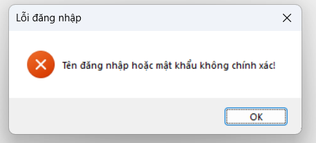 |

- **Mô tả:** Cơ chế xác thực tại sự kiện `btnLogin_Click` được kiểm soát chặt chẽ qua hai lớp kiểm tra:
  - **Kiểm tra trường dữ liệu rỗng:** Sử dụng `string.IsNullOrEmpty` đối với tên đăng nhập và mật khẩu. Nếu người dùng bỏ trống một trong hai ô, hệ thống bật ngay thông báo cảnh báo `MessageBoxIcon.Warning` nhắc nhở người dùng nhập đầy đủ.
  - **So khớp thông tin tài khoản:** Tìm kiếm đối tượng người dùng tương ứng trong danh sách `DataStore.Users` không phân biệt chữ hoa chữ thường đối với username (`StringComparison.OrdinalIgnoreCase`).
  - **Xử lý khi sai thông tin:** Hiển thị hộp thoại lỗi `MessageBoxIcon.Error` với thông báo *"Tên đăng nhập hoặc mật khẩu không chính xác!"*, đồng thời tự động xóa trắng ô mật khẩu (`txtPassword.Clear()`) và chuyển con trỏ soạn thảo về lại ô mật khẩu để nhập lại.
  - **Xử lý khi đăng nhập thành công:** Lưu thông tin tài khoản vào thuộc tính `LoggedInUser`, gán `DialogResult = DialogResult.OK` và đóng Form đăng nhập để bàn giao luồng điều khiển cho Form chính.

---

## 3. Màn hình chính MDI Parent, MenuStrip & StatusStrip (FrmMain)

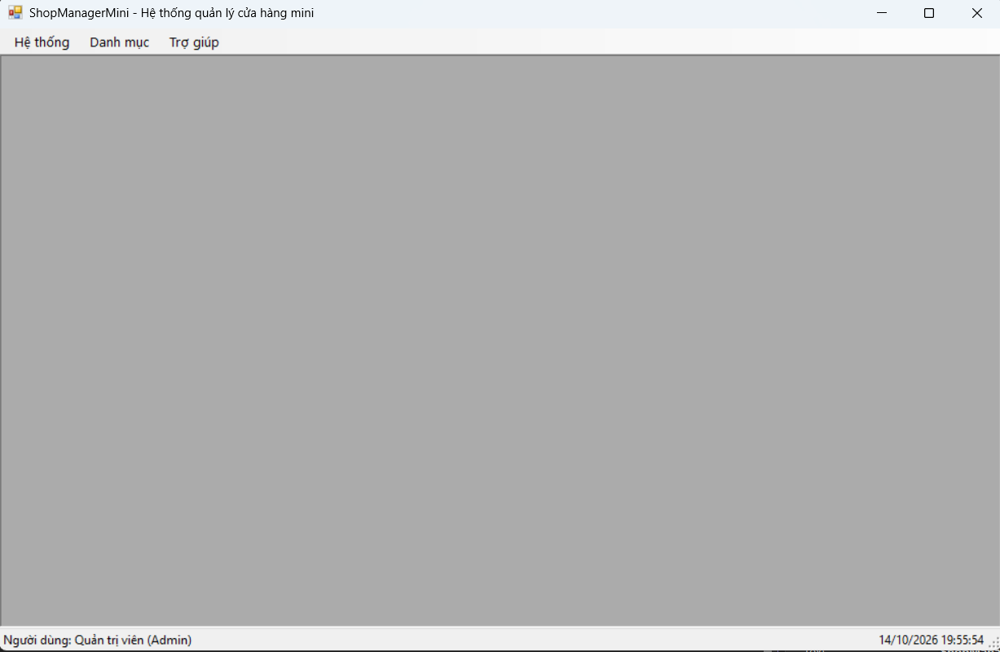

- **Mô tả:** Sau khi đăng nhập thành công, `FrmMain` được khởi tạo và nhận đối tượng `User` thông qua phương thức khởi tạo (Constructor). Form chính đóng vai trò là khung chứa **MDI Parent**, quản lý toàn bộ các Form nghiệp vụ con:
- **Thiết lập & Cấu hình chuẩn MDI:**
  - `IsMdiContainer = true`: Kích hoạt không gian làm việc đa tài liệu (MDI Workspace).
  - Khởi chạy ở chế độ phóng to toàn màn hình: `WindowState = FormWindowState.Maximized`.
  - Tiêu đề Form: `ShopManagerMini - Hệ thống quản lý cửa hàng mini`.
- **Hệ thống thanh Menu điều hướng (`MenuStrip`):**
  - **Hệ thống:**
    - *Đăng xuất* (`mnuDangXuat`): Kết thúc phiên làm việc của người dùng hiện tại và quay về màn hình đăng nhập.
    - Phân cách trực quan (`ToolStripSeparator`).
    - *Thoát* (`mnuThoat`): Thoát khỏi toàn bộ ứng dụng (có hỏi xác nhận).
  - **Danh mục:**
    - *Quản lý sản phẩm* (`mnuSanPham`): Mở màn hình quản lý sản phẩm `FrmProduct`.
    - *Quản lý khách hàng* (`mnuKhachHang`): Mở màn hình quản lý khách hàng `FrmCustomer`.
  - **Trợ giúp:**
    - *Giới thiệu* (`mnuGioiThieu`): Mở màn hình thông tin đồ án và sinh viên `FrmAbout`.
- **Thanh trạng thái chân trang (`StatusStrip`):**
  - `lblUser`: Hiển thị rõ ràng họ tên và vai trò của tài khoản đang đăng nhập (ví dụ: `Người dùng: Quản trị viên (Admin)`).
  - `lblSpacer`: Thành phần đệm với thuộc tính `Spring = true`, tự động co dãn chiếm toàn bộ khoảng trống ở giữa để đẩy đồng hồ sang sát góc phải.
  - `lblTime`: Đồng hồ hiển thị thời gian hiện tại (`dd/MM/yyyy HH:mm:ss`), được cập nhật đều đặn mỗi giây thông qua component `Timer`.

---

## 4. Quản lý đa Form & Cơ chế chống mở trùng Form con (MDI Activation)

| Mở đồng thời nhiều Form con trong Form chính | Kích hoạt lại Form cũ khi chọn lại Menu |
| :---: | :---: |
| 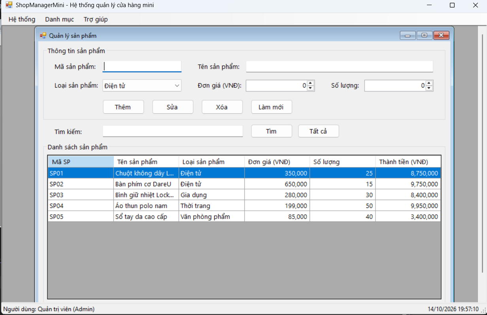 | 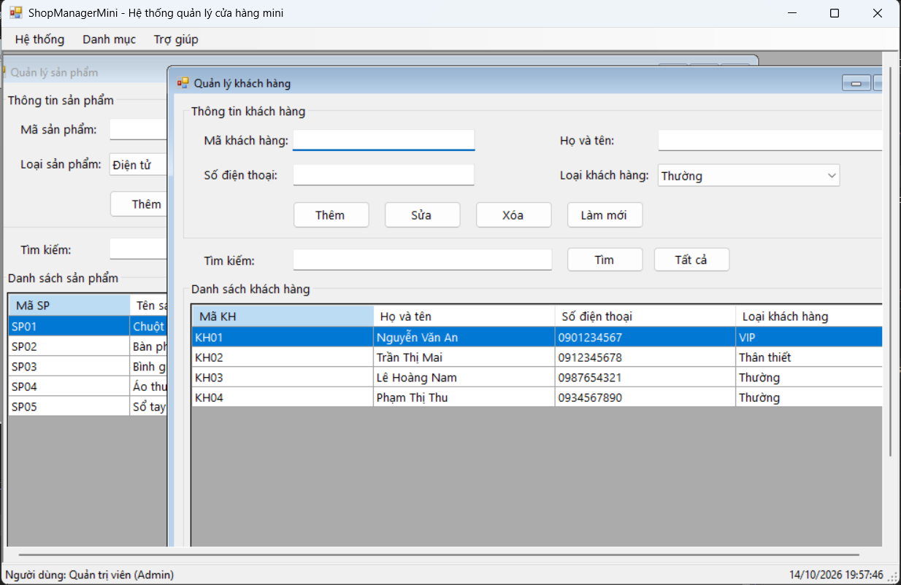 |

- **Mô tả:** Đề bài yêu cầu *"Các Form con phải mở bên trong FrmMain, không mở thành cửa sổ rời"* và *"Nếu Form con cùng loại đang mở, không tạo Form mới mà kích hoạt Form cũ"*:
  - Toàn bộ các Form con (`FrmProduct`, `FrmCustomer`, `FrmAbout`) khi khởi tạo đều được gán `MdiParent = this`, đảm bảo cửa sổ luôn nằm trọn trong vùng làm việc của `FrmMain`.
  - **Phương thức chống mở trùng Form chuẩn mực (`CheckFormExists`):**
    ```csharp
    // Kích hoạt Form con nếu đã mở, trả về true nếu đã tồn tại
    private bool CheckFormExists(Type formType)
    {
        foreach (Form child in this.MdiChildren)
        {
            if (child.GetType() == formType)
            {
                child.Activate();
                if (child.WindowState == FormWindowState.Minimized)
                    child.WindowState = FormWindowState.Normal;
                return true;
            }
        }
        return false;
    }
    ```
  - **Nguyên lý hoạt động:** Khi người dùng nhấp chọn menu (ví dụ: *Quản lý sản phẩm*), chương trình duyệt qua mảng `this.MdiChildren`:
    - Nếu đã có một Form có kiểu `FrmProduct`, chương trình lập tức kích hoạt (`child.Activate()`), nếu Form đang bị thu nhỏ dưới đáy thì khôi phục về kích thước chuẩn (`FormWindowState.Normal`), và trả về `true` để ngăn việc tạo Form mới.
    - Chỉ khi chưa có Form nào thuộc kiểu đó thì mới tạo đối tượng mới và hiển thị bằng `.Show()`.

---

## 5. Quản lý sản phẩm với DataGridView & BindingList (FrmProduct)

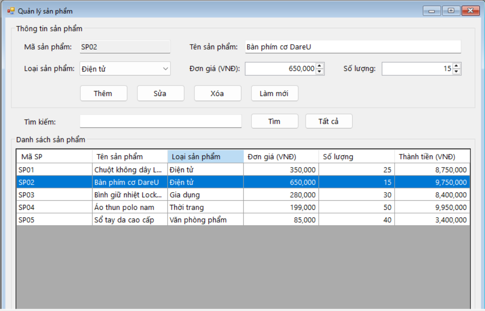

- **Mô tả:** Màn hình `FrmProduct` được thiết kế khoa học với 2 khu vực rõ ràng: cụm nhập liệu phía trên và danh sách lưới dữ liệu chiếm toàn bộ không gian phía dưới:
- **Cấu hình DataGridView chuẩn mực (`dgvProduct`):**
  - Liên kết trực tiếp hai chiều với danh mục sản phẩm: `dgvProduct.DataSource = DataStore.Products` (kiểu `BindingList<Product>`).
  - `ReadOnly = true`: Chống chỉnh sửa tùy tiện trực tiếp trên ô lưới.
  - `SelectionMode = FullRowSelect`: Chọn nguyên dòng dữ liệu khi người dùng click chuột.
  - `MultiSelect = false`: Chỉ cho phép chọn duy nhất 1 dòng tại một thời điểm.
  - `AllowUserToAddRows = false`: Ẩn hàng trống mặc định ở cuối bảng.
  - Tiêu đề cột tiếng Việt rõ ràng: *Mã SP*, *Tên sản phẩm*, *Loại sản phẩm*, *Đơn giá (VNĐ)*, *Số lượng*, *Thành tiền (VNĐ)*.
  - Căn lề và định dạng số học: Các cột *Đơn giá*, *Số lượng*, *Thành tiền* căn lề phải (`MiddleRight`) và định dạng phân cách hàng nghìn chuẩn (`#,##0`).

---

## 6. Các thao tác CRUD sản phẩm an toàn & Tìm kiếm theo thời gian thực

| Thêm mới sản phẩm thành công | Hộp thoại xác nhận trước khi xóa |
| :---: | :---: |
| 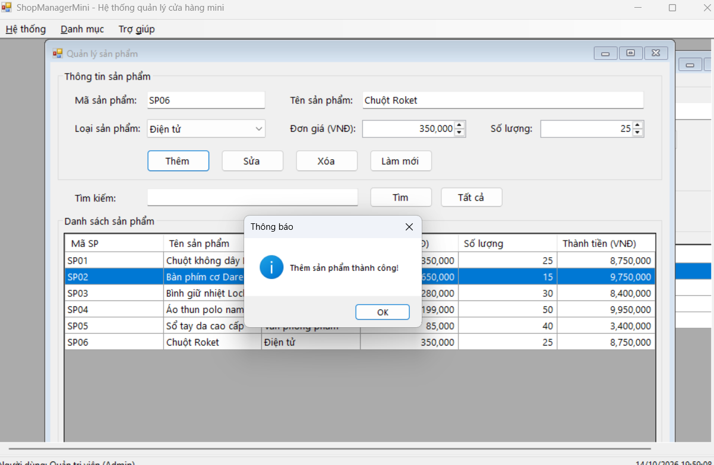 | 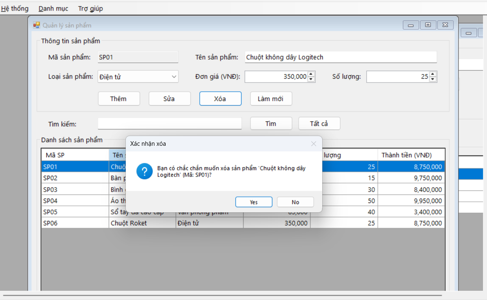 |

- **Mô tả các thao tác xử lý dữ liệu:**
  - **Thêm sản phẩm (`btnThem_Click`):**
    - Kiểm tra bắt buộc nhập Mã SP và Tên SP.
    - Kiểm tra trùng mã: `DataStore.Products.Any(p => p.MaSP.Equals(maSP, StringComparison.OrdinalIgnoreCase))` -> Nếu mã đã có trong danh sách, bật cảnh báo không cho thêm trùng lặp.
    - Đơn giá và số lượng được nhập bằng `NumericUpDown`: Ngăn chặn hoàn toàn việc nhập số âm hoặc nhập sai ký tự chữ, kiểm tra Đơn giá bắt buộc phải lớn hơn `0`.
    - Sau khi thêm, `BindingList<Product>` tự động đồng bộ dòng mới vào `DataGridView` mà không cần reload thủ công.
  - **Xem & Sửa sản phẩm (`btnSua_Click`):**
    - Khi người dùng click chuột vào dòng trên bảng (`CellClick`), toàn bộ thông tin sản phẩm được nạp lên các control nhập liệu.
    - Tự động thiết lập `txtMaSP.ReadOnly = true` để khóa mã sản phẩm, ngăn người dùng thay đổi khóa chính làm sai lệch dữ liệu.
    - Cập nhật thông tin mới vào đối tượng và gọi `dgvProduct.Refresh()` để hiển thị ngay kết quả.
  - **Xóa sản phẩm (`btnXoa_Click`):**
    - Bật hộp thoại xác nhận `MessageBox.Show` hai nút `Yes / No` (`MessageBoxIcon.Question`) kèm theo tên và mã sản phẩm chuẩn bị xóa.
    - Chỉ xóa khỏi danh sách khi người dùng nhấn `Yes`, sau đó làm sạch form nhập liệu.
  - **Làm mới (`btnLamMoi_Click`):**
    - Xóa trắng vùng nhập liệu, mở lại khóa ô mã sản phẩm (`txtMaSP.ReadOnly = false`), đưa con trỏ về `txtMaSP.Focus()` để sẵn sàng nhập mới.
  - **Tìm kiếm sản phẩm (`btnTimKiem_Click` & `btnTatCa_Click`):**
    - Tìm kiếm đồng thời theo **Mã sản phẩm** hoặc **Tên sản phẩm**, không phân biệt chữ hoa thường.
    - Lọc dữ liệu tức thì và hiển thị lên `DataGridView` thông qua `BindingList<Product>` tạm. Nút **Tất cả** giúp hoàn nguyên danh sách gốc chỉ với 1 cú click.

---

## 7. Quản lý khách hàng (FrmCustomer - CRUD khách hàng trong bộ nhớ)

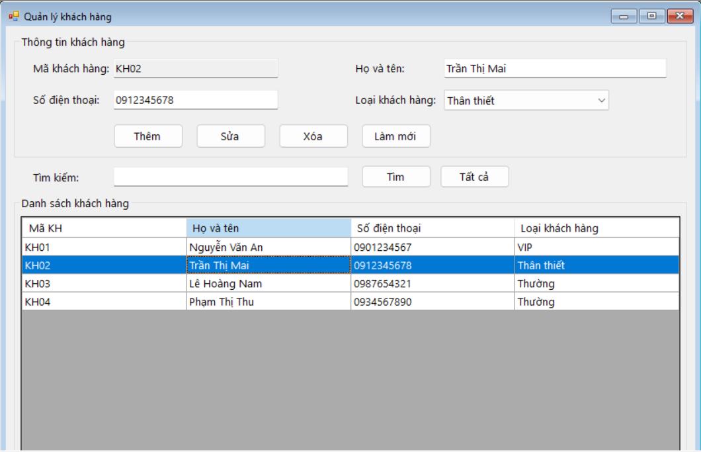

- **Mô tả:** Màn hình `FrmCustomer` được xây dựng đồng bộ về kiểu dáng và phong cách với màn hình sản phẩm, cung cấp đầy đủ các thao tác quản lý khách hàng:
  - **Mô hình khách hàng (`Customer`):** Lưu trữ 4 trường thông tin chuẩn theo đề bài: `MaKH` (Mã khách hàng), `HoTen` (Họ và tên), `SoDienThoai` (Số điện thoại), `LoaiKH` (Loại khách hàng gồm: *Thường*, *Thân thiết*, *VIP*).
  - **Chức năng thêm mới:** Kiểm tra bắt buộc điền đủ mã, họ tên, số điện thoại; kiểm tra không trùng mã khách hàng.
  - **Chức năng sửa & xóa:** Click dòng trên lưới để xem chi tiết, sửa thông tin khách hàng hoặc xóa khách hàng sau khi xác nhận an toàn qua `MessageBox`.
  - **Tìm kiếm đa năng:** Cho phép tra cứu khách hàng nhanh theo cả Mã khách hàng, Họ tên hoặc Số điện thoại.

---

## 8. Màn hình Giới thiệu (FrmAbout) & Đăng xuất, Xác nhận thoát

| Form Giới thiệu tác giả & Đề tài (MDI Child) | Hộp thoại xác nhận trước khi thoát ứng dụng |
| :---: | :---: |
| 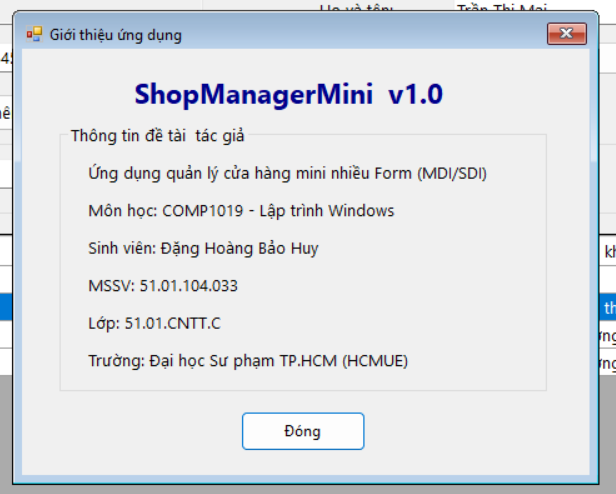 | 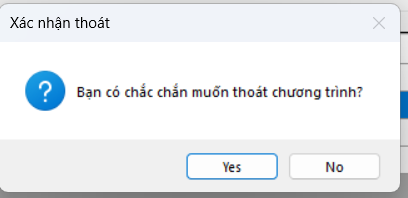 |

- **Form Giới thiệu (`FrmAbout`):**
  - Mở dạng Form con MDI bên trong `FrmMain` (áp dụng chung cơ chế chống mở trùng).
  - Hiển thị đầy đủ thông tin:
    - Tên ứng dụng: **ShopManagerMini v1.0**
    - Môn học: **COMP1019 - Lập trình trên Windows**
    - Sinh viên thực hiện: **Đặng Hoàng Bảo Huy**
    - MSSV: **51.01.104.033** | Lớp: **51.01.CNTT.C**
    - Trường: **Đại học Sư phạm TP.HCM (HCMUE)**
    - Nút *Đóng* cho phép đóng nhanh Form giới thiệu.
- **Xử lý Đăng xuất an toàn:**
  - Chọn menu *Hệ thống -> Đăng xuất*: Đặt cờ `IsLoggingOut = true`, đóng `FrmMain` và tự động hiển thị lại `FrmLogin` để đăng nhập bằng tài khoản khác mà không cần khởi động lại tiến trình.
- **Xác nhận trước khi thoát:**
  - Bắt sự kiện `FrmMain_FormClosing`: Nếu người dùng nhấp nút Thoát trên Menu hoặc nút tắt [X] ở góc phải Form, hệ thống bật hộp thoại hỏi *"Bạn có chắc chắn muốn thoát chương trình?"*. Nếu chọn `No`, thiết lập `e.Cancel = true` giữ nguyên trạng thái ứng dụng.

---

## 9. Cấu trúc mã nguồn chuẩn mực

Kiến trúc ứng dụng được phân chia rõ ràng theo từng gói chức năng, bám sát khuyến nghị tại Mục 8 của `Lab07.md`:

```text
ShopManagerMini (Lab07)
├── Models/
│   ├── User.cs            # Lớp thực thể tài khoản người dùng (Username, Password, FullName, Role)
│   ├── Product.cs         # Lớp thực thể sản phẩm (MaSP, TenSP, LoaiSP, DonGia, SoLuong, ThanhTien)
│   └── Customer.cs        # Lớp thực thể khách hàng (MaKH, HoTen, SoDienThoai, LoaiKH)
├── Data/
│   └── DataStore.cs       # Kho dữ liệu tĩnh trong bộ nhớ (Users, Products, Customers)
├── Forms/
│   ├── FrmLogin.cs        # Form đăng nhập SDI modal
│   ├── FrmMain.cs         # Form chính MDI Parent quản lý các Form con
│   ├── FrmProduct.cs      # Form quản lý danh mục sản phẩm (CRUD)
│   ├── FrmCustomer.cs     # Form quản lý danh mục khách hàng (CRUD)
│   └── FrmAbout.cs        # Form hiển thị thông tin tác giả và đồ án
├── Program.cs             # Điểm điều phối vòng đời ứng dụng
└── Lab07.csproj           # Cấu hình dự án Visual Studio
```

---

## 10. Trả lời chi tiết 5 câu hỏi nộp kèm 

### Câu 1: SDI và MDI khác nhau như thế nào?
- **SDI (Single Document Interface):** Mỗi cửa sổ làm việc hoạt động hoàn toàn độc lập, sở hữu thanh tiêu đề riêng và xuất hiện thành các mục riêng biệt trên thanh tác vụ (Taskbar) của Windows (ví dụ: ứng dụng Notepad, Calculator).
- **MDI (Multiple Document Interface):** Một cửa sổ cha trung tâm (`IsMdiContainer = true`) đóng vai trò là vùng chứa quản lý nhiều cửa sổ con (`MdiParent = parentForm`) bên trong không gian làm việc của nó. Các cửa sổ con không trôi nổi ra ngoài cửa sổ cha, giúp gom nhóm quản lý khoa học (ví dụ: Visual Studio, Adobe Photoshop).

### Câu 2: Vì sao Form đăng nhập nên dùng `ShowDialog()`?
- `ShowDialog()` mở Form ở chế độ **modal**, có tác dụng chặn tương tác với tất cả các cửa sổ khác của ứng dụng và dừng luồng thực thi code tại lệnh gọi cho đến khi Form đóng lại.
- Đặc biệt, `ShowDialog()` trả về kết quả kiểu `DialogResult` (`DialogResult.OK` hoặc `DialogResult.Cancel`), giúp hàm điều phối `Main()` trong `Program.cs` nhận diện được người dùng đã đăng nhập thành công hay bấm nút thoát, từ đó quyết định có cấp quyền mở tiếp Form chính hay kết thúc chương trình.

### Câu 3: Trong bài lab này, dữ liệu user được truyền từ `FrmLogin` sang `FrmMain` bằng cách nào?
- Trong `FrmLogin`, khi kiểm tra đăng nhập đúng tài khoản mẫu, thông tin user được gán vào thuộc tính công khai `public User LoggedInUser { get; private set; }`.
- Tại `Program.cs`, sau khi `login.ShowDialog()` trả về `DialogResult.OK`, chương trình trích xuất thuộc tính này và truyền trực tiếp vào **Constructor** của `FrmMain`:
  ```csharp
  using (FrmMain main = new FrmMain(login.LoggedInUser))
  {
      Application.Run(main);
  }
  ```
- Form chính nhận đối tượng `User` qua constructor và nạp họ tên, vai trò lên thanh `StatusStrip`.

### Câu 4: Nếu người dùng bấm menu sản phẩm nhiều lần, chương trình xử lý như thế nào để không mở trùng Form?
- `FrmMain` cài đặt phương thức kiểm tra `CheckFormExists(Type formType)` duyệt qua mảng `this.MdiChildren`:
  - Nếu tìm thấy một Form con có kiểu dữ liệu trùng khớp (`child.GetType() == formType`), chương trình sẽ kích hoạt lại Form đó bằng `child.Activate()`, khôi phục kích thước `Normal` nếu đang thu nhỏ và trả về `true`.
  - Chương trình sẽ không tạo thêm thể hiện mới (`new FrmProduct()`), nhờ đó trên giao diện luôn chỉ tồn tại duy nhất một Form quản lý sản phẩm.

### Câu 5: Khi nào nên dùng `constructor`, khi nào nên dùng `property` để truyền dữ liệu giữa các Form?
- **Dùng Constructor:** Khi dữ liệu là **bắt buộc** phải có ngay tại thời điểm khởi tạo Form thì Form mới có thể hoạt động đúng nghiệp vụ (ví dụ: `FrmMain` bắt buộc phải có đối tượng `User` thì mới hiển thị được danh tính và vai trò trên thanh trạng thái).
- **Dùng Property:** Khi dữ liệu là **tùy chọn**, có thể gán trước hoặc sau khi Form hiển thị, hoặc đặc biệt là dùng để **lấy dữ liệu ra** từ Form con sau khi đóng lại (ví dụ: `Program.cs` đọc thuộc tính `LoggedInUser` từ `FrmLogin` sau khi `FrmLogin` đã đóng với kết quả `DialogResult.OK`).
