# BÁO CÁO KẾT QUẢ THỰC HÀNH LAB 08
**Học phần:** COMP1019 - Lập trình trên Windows  
**Đề tài:** Xây dựng ứng dụng Paint đơn giản bằng WinForms và GDI+ (SimplePaint)  
**Sinh viên thực hiện:** Đặng Hoàng Bảo Huy | **MSSV:** 51.01.104.033 | **Lớp:** 51.01.CNTT.C  

---

## 1. Giao diện ứng dụng khi khởi tạo (Form Load)

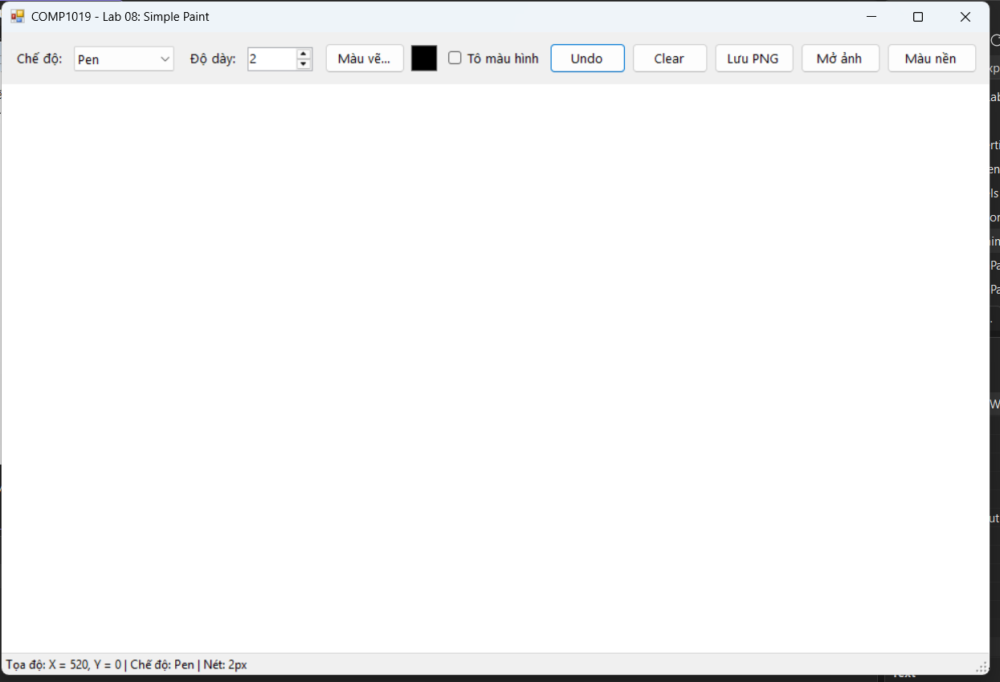

- **Mô tả:** Khi ứng dụng **SimplePaint** khởi chạy, Form chính `FrmPaint` mở ra với bố cục trực quan, tối ưu cho thao tác vẽ:
- **Thiết lập mặc định ban đầu:**
  - Tiêu đề Form: `COMP1019 - Lab 08: Simple Paint`, tự động căn giữa màn hình (`StartPosition = CenterScreen`).
  - Thanh công cụ điều khiển trên cùng (`pnlToolbar`):
    - `cboMode`: Mặc định chọn chế độ vẽ tự do `Pen`. Danh sách hỗ trợ đủ 4 chế độ: `Pen`, `Line`, `Rectangle`, `Ellipse`.
    - `nudWidth`: Độ dày nét vẽ mặc định là `2` px (hỗ trợ điều chỉnh linh hoạt từ 1 đến 20 px).
    - `pnlColorPreview`: Ô vuông hiển thị màu vẽ hiện tại, mặc định là màu đen (`Color.Black`).
    - `chkFill`: Hộp chọn chế độ tô màu đặc cho hình chữ nhật và elip (mặc định chưa chọn).
    - Hệ thống nút bấm chức năng: `Màu vẽ...`, `Undo`, `Clear`, `Lưu PNG`, `Mở ảnh`, `Màu nền`.
  - Vùng vẽ chính (`canvas`):
    - Nền trắng tinh khiết (`BackColor = Color.White`).
    - Con trỏ chuột chuyển sang dạng chữ thập (`Cursors.Cross`) giúp canh tọa độ chính xác.
    - Kích hoạt cơ chế bộ đệm đôi `DoubleBuffered` kết hợp xử lý xóa nền trong sự kiện `Paint`, triệt tiêu hoàn toàn hiện tượng nhấp nháy hình khi di chuột liên tục.
  - Thanh trạng thái chân trang (`lblStatus`): Hiển thị tọa độ chuột theo thời gian thực: `Tọa độ: X = ..., Y = ... | Chế độ: ... | Nét: ...px`.

---

## 2. Bốn chế độ vẽ cơ bản (Pen, Line, Rectangle, Ellipse)

| Vẽ tự do (Pen) & Đường thẳng (Line) | Vẽ Hình chữ nhật & Hình elip (Rectangle & Ellipse) |
| :---: | :---: |
| 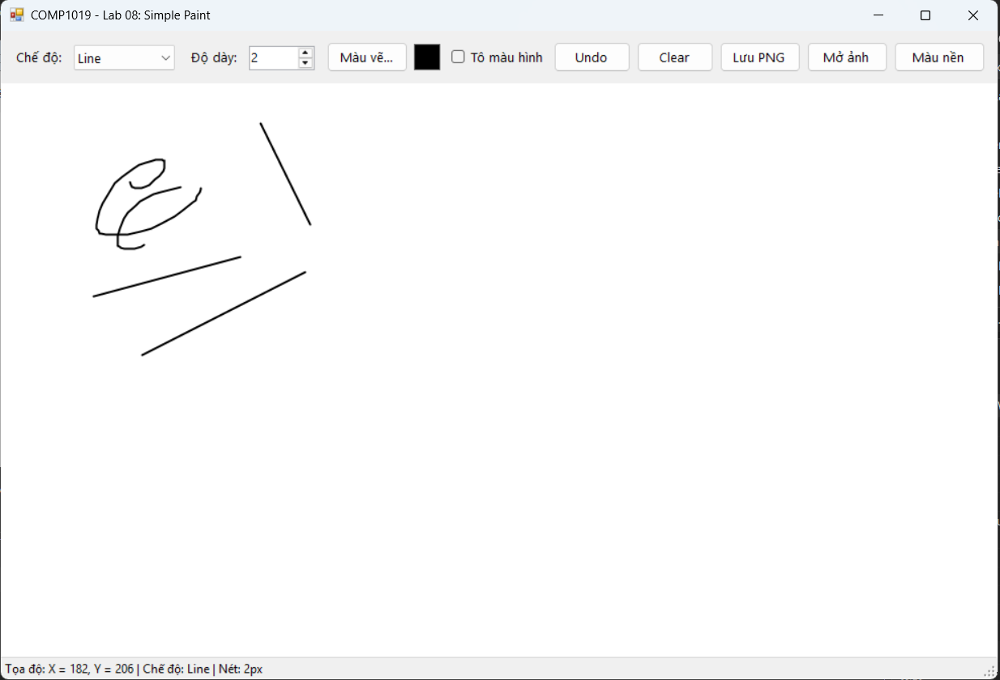 | 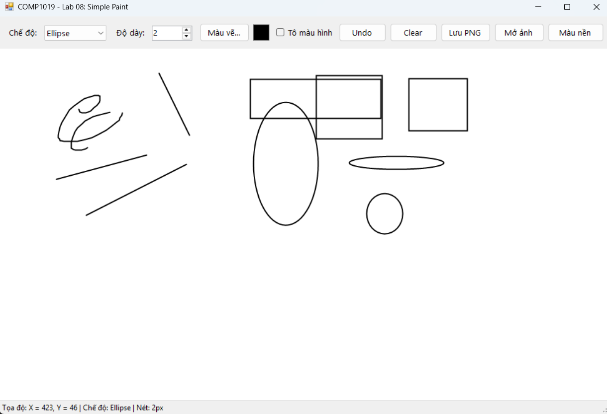 |

- **Mô tả chi tiết 4 chế độ vẽ:**
  1. **Chế độ Pen (Vẽ tự do):**
     - Bắt đầu khi người dùng nhấn chuột trái (`MouseDown`), liên tục ghi nhận các điểm tọa độ di chuyển (`MouseMove`) vào danh sách `Points`.
     - Sử dụng `g.DrawLines()` với các đầu nét bo tròn (`LineCap.Round`) tạo ra nét vẽ uốn lượn mềm mại, liền mạch và tự nhiên.
  2. **Chế độ Line (Đường thẳng):**
     - Xác định điểm bắt đầu tại vị trí nhấn chuột (`StartPoint`) và điểm kết thúc tại vị trí thả chuột (`EndPoint`).
     - Vẽ chính xác đường nối giữa 2 điểm bằng `g.DrawLine()`.
  3. **Chế độ Rectangle (Hình chữ nhật):**
     - Tính toán hộp bao từ hai điểm kéo chuột thông qua hàm chuẩn hóa `GetBoundingRectangle`.
     - Cho phép kéo chuột theo bất kỳ hướng nào (trên xuống, dưới lên, trái qua phải, phải qua trái).
  4. **Chế độ Ellipse (Hình elip):**
     - Tương tự hình chữ nhật, hình elip được vẽ nội tiếp bên trong hình chữ nhật bao quanh xác định bởi 2 điểm kéo chuột.

---

## 3. Chọn màu vẽ & Tùy chỉnh độ dày nét (Color & Stroke Width)

| Hộp thoại chọn màu vẽ ColorDialog & Nét vẽ với các độ dày khác nhau |
| :---: |
| 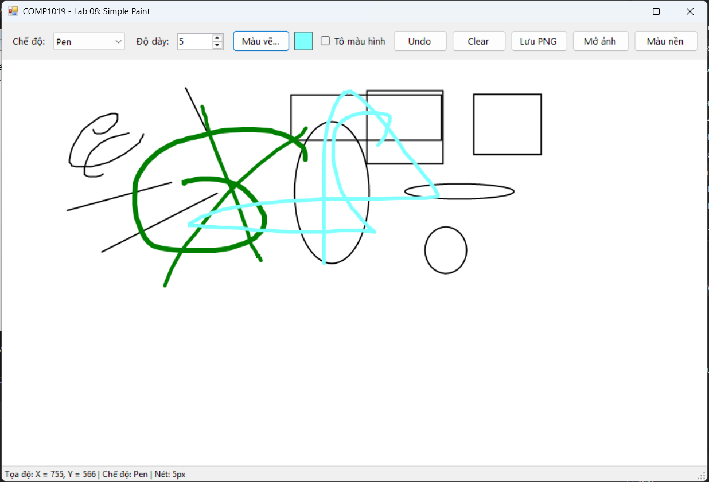 |

- **Chọn màu vẽ (`btnColor_Click`):**
  - Mở hộp thoại chuẩn `ColorDialog` của Windows, cho phép chọn màu cơ bản hoặc pha màu tùy chỉnh (Custom Colors).
  - Màu được chọn lập tức cập nhật lên ô xem trước `pnlColorPreview` và áp dụng cho các nét vẽ tiếp theo.
- **Tùy chỉnh độ dày nét vẽ (`nudWidth`):**
  - Điều khiển bằng `NumericUpDown` với giới hạn từ `1` đến `20` px.
  - Mỗi khi thay đổi giá trị, thanh trạng thái chân trang lập tức cập nhật thông số độ dày nét vẽ hiện tại.

---

## 4. Chế độ xem trước thời gian thực (Live Preview) & Chuẩn hóa kéo chuột

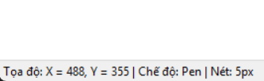

- **Cơ chế xem trước (Live Preview):**
  - Trong quá trình rê chuột (`MouseMove` khi `isDrawing == true`), đối tượng `currentItem` được cập nhật tọa độ tạm thời và lệnh `canvas.Invalidate()` được gọi.
  - Sự kiện `canvas_Paint` vẽ toàn bộ các hình cũ, sau đó vẽ đè `currentItem` lên trên cùng. Người dùng nhìn thấy rõ hình dạng và kích thước sẽ vẽ trước khi quyết định nhả chuột.
- **Thuật toán chuẩn hóa hộp bao kéo chuột mọi hướng:**
  ```csharp
  public static Rectangle GetBoundingRectangle(Point p1, Point p2)
  {
      return new Rectangle(
          Math.Min(p1.X, p2.X),
          Math.Min(p1.Y, p2.Y),
          Math.Abs(p1.X - p2.X),
          Math.Abs(p1.Y - p2.Y)
      );
  }
  ```
  - `Math.Min(p1.X, p2.X)` và `Math.Min(p1.Y, p2.Y)` luôn lấy tọa độ góc trên-bên-trái bất kể người dùng kéo chuột theo hướng nào.
  - `Math.Abs(...)` đảm bảo chiều rộng và chiều cao luôn là số dương, khắc phục hoàn toàn lỗi crash hình khi kéo ngược chuột.

---

## 5. Lưu trữ nét vẽ & Chống mất hình khi Resize / Refresh (GDI+ Paint Event)

| Trước khi thay đổi kích thước cửa sổ | Sau khi phóng to toàn màn hình (Dữ liệu nguyên vẹn) |
| :---: | :---: |
| 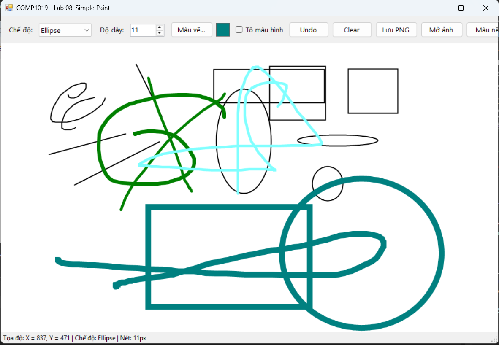 | 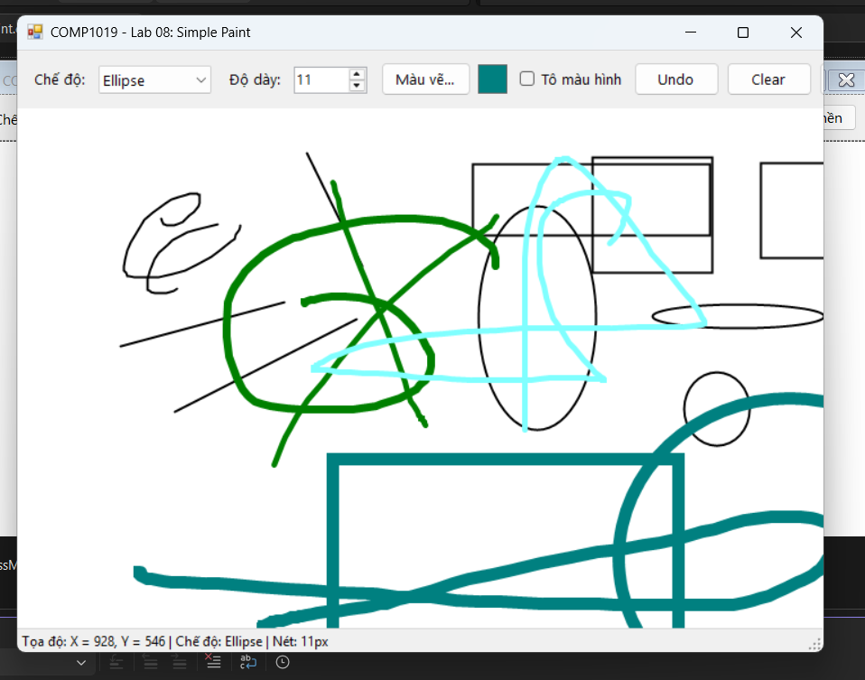 |

- **Mô tả kiến trúc dữ liệu bền vững:**
  - Đề bài quy định nghiêm ngặt: *"Phải vẽ trong sự kiện Paint của vùng canvas. Không được chỉ vẽ trực tiếp trong MouseMove rồi bỏ qua dữ liệu gốc"*.
  - Toàn bộ các nét vẽ sau khi hoàn thành (`MouseUp`) đều được lưu trữ trong danh sách `List<DrawItem> items`.
  - Khi Form bị thay đổi kích thước (`Resize`), bị che khuất rồi hiển thị lại, hệ điều hành phát tín hiệu vẽ lại (`WM_PAINT`), sự kiện `canvas_Paint` tự động duyệt danh sách `items` và kết xuất lại toàn bộ các đối tượng một cách trung thực và sắc nét.

---

## 6. Chức năng Hoàn tác (Undo) & Phím tắt Ctrl + Z

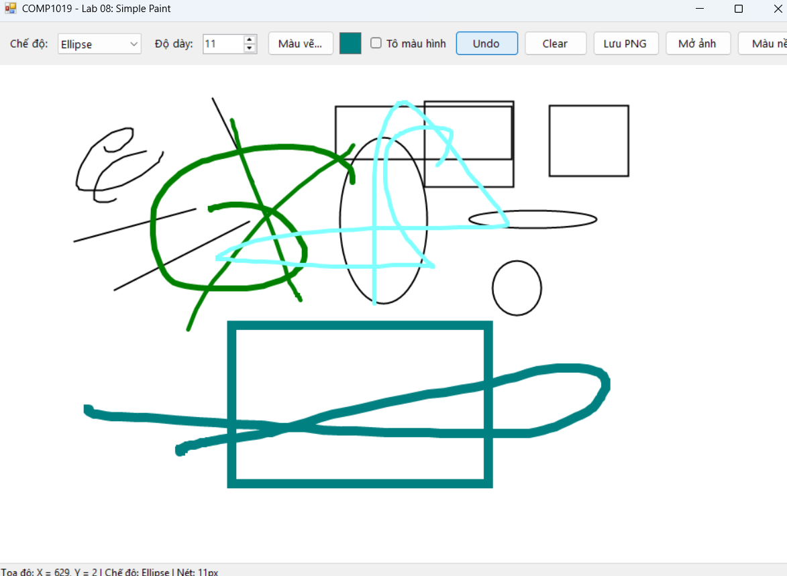

- **Mô tả:**
  - Hỗ trợ loại bỏ nét vẽ cuối cùng khỏi vùng vẽ mà không ảnh hưởng đến các hình vẽ trước đó.
  - **Phương thức thực hiện:** Lấy phần tử cuối cùng ra khỏi danh sách `items.RemoveAt(items.Count - 1)` và gọi `canvas.Invalidate()`.
  - **Tích hợp phím tắt nhanh:** Kích hoạt thuộc tính `KeyPreview = true` trên Form, bắt tổ hợp phím `Ctrl + Z` trong sự kiện `KeyDown` để kích hoạt `PerformUndo()` tương tự như nhấn nút trên thanh công cụ.

---

## 7. Xóa toàn bộ vùng vẽ (Clear Canvas) có xác nhận an toàn

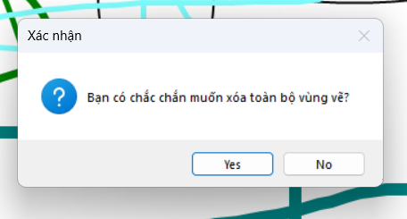

- **Mô tả:**
  - Khi người dùng nhấn nút **Clear** (`btnClear_Click`), nếu trên vùng vẽ đang có nét vẽ hoặc ảnh nền, hệ thống hiển thị hộp thoại xác nhận `MessageBox.Show` hai nút `Yes / No` (`MessageBoxIcon.Question`).
  - Nếu chọn `Yes`: Toàn bộ danh sách `items` được dọn sạch (`items.Clear()`), ảnh nền được giải phóng bộ nhớ (`Dispose`), vùng canvas trở về trạng thái trống ban đầu.
  - Nếu chọn `No`: Giữ nguyên toàn bộ nội dung vẽ hiện tại.

---

## 8. Các chức năng nâng cao (Advanced Features - Đạt điểm tối đa)

| Lưu file ảnh PNG chất lượng cao | Mở ảnh nền và vẽ đè lên ảnh |
| :---: | :---: |
| 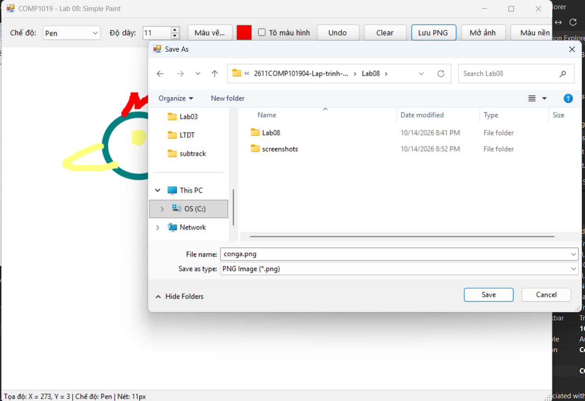 | 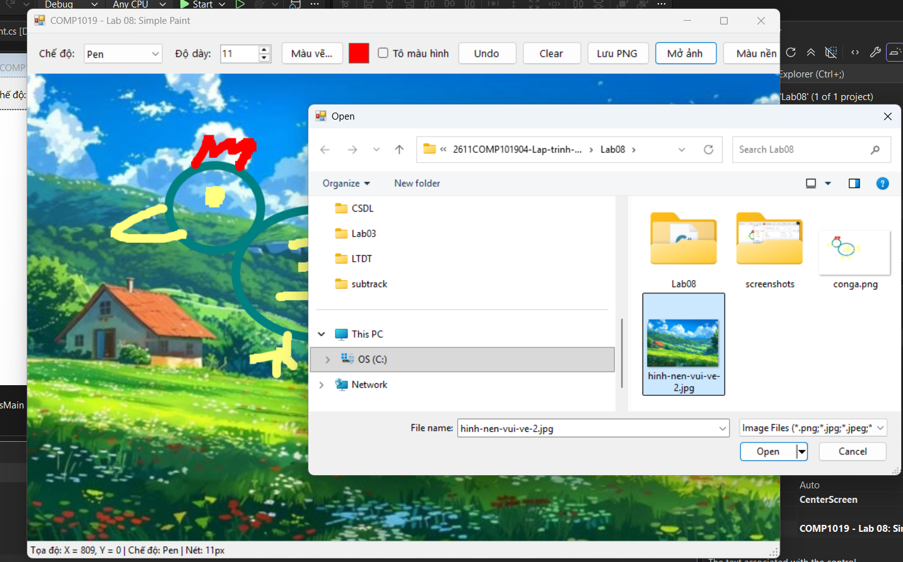 |
| **Chế độ tô màu đặc (Fill Shape)** | **Đổi màu nền vùng vẽ Canvas** |
| 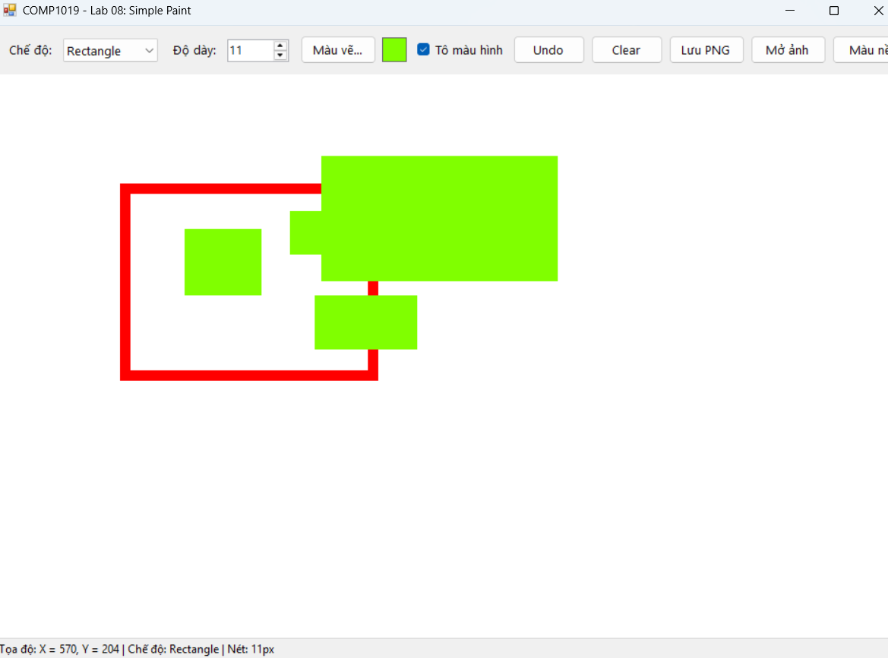 | 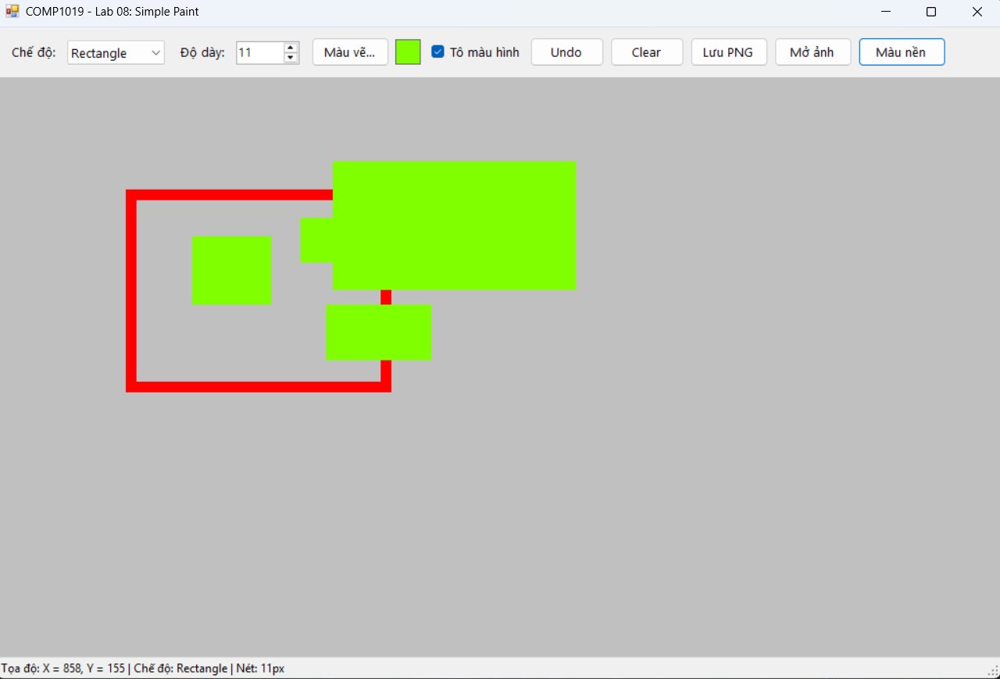 |

- **1. Lưu vùng vẽ ra tệp ảnh PNG (`btnSave`):**
  - Sử dụng `SaveFileDialog` với bộ lọc `*.png`.
  - Khởi tạo một đối tượng `Bitmap` đúng bằng kích thước vùng `canvas`, sử dụng `Graphics.FromImage(bmp)` để vẽ toàn bộ nền và danh sách các nét vẽ lên ảnh, sau đó lưu ra file với định dạng `ImageFormat.Png`.
- **2. Mở ảnh nền để vẽ đè (`btnOpen`):**
  - Sử dụng `OpenFileDialog` cho phép chọn ảnh định dạng `*.png; *.jpg; *.jpeg; *.bmp`.
  - Nạp ảnh an toàn vào biến `backgroundImage`, tự động vẽ co dãn phủ kín canvas trong sự kiện `canvas_Paint`.
- **3. Chế độ tô màu hình (`chkFill`):**
  - Khi tích chọn **Tô màu hình**, hình chữ nhật và hình elip sẽ được tô đặc bằng cọ `SolidBrush` cùng màu với viền trước khi vẽ viền ngoài, tạo ra các khối hình đặc màu chuyên nghiệp.
- **4. Đổi màu nền canvas (`btnBgColor`):**
  - Mở `ColorDialog` cho phép người dùng tùy chọn bất kỳ màu nền nào cho vùng vẽ thay vì chỉ cố định màu trắng.

---

## 9. Cấu trúc mã nguồn & Tối ưu hóa hiệu năng GDI+

### Bảng phân bố tệp tin và vai trò

| Tệp tin | Thư mục | Vai trò trong hệ thống |
| :--- | :--- | :--- |
| `ShapeMode.cs` | `Models/` | Enum định nghĩa 4 chế độ vẽ: `Pen`, `Line`, `Rectangle`, `Ellipse` |
| `DrawItem.cs` | `Models/` | Lớp mô hình lưu trữ đối tượng đồ họa và hàm kết xuất `Draw(Graphics)` |
| `FrmPaint.cs` | `Gốc project` | Xử lý sự kiện chuột, thuật toán vẽ GDI+, Undo, Clear, Lưu và Mở ảnh |
| `FrmPaint.Designer.cs` | `Gốc project` | Bố cục thành phần giao diện gồm Toolbar, Canvas và StatusStrip |
| `Program.cs` | `Gốc project` | Điểm khởi chạy ứng dụng Windows Forms |

### Kỹ thuật tối ưu hóa & Quản lý bộ nhớ:
- **Khử giật hình (Anti-Flickering):**
  - Kích hoạt cơ chế bộ đệm đôi `DoubleBuffered` kết hợp các cờ phong cách `AllPaintingInWmPaint`, `UserPaint`, `OptimizedDoubleBuffer`.
  - Toàn bộ nội dung nền và các nét vẽ được xóa và kết xuất hoàn toàn trên bộ đệm ảo (Off-screen buffer) trước khi đẩy ra màn hình, loại bỏ triệt để hiện tượng chớp trắng.
- **Giải phóng tài nguyên GDI+ an toàn:**
  - Toàn bộ các đối tượng `Pen`, `Brush`, `Bitmap`, `Graphics` đều được bao bọc trong khối lệnh `using (...)` để đảm bảo cơ chế `IDisposable` tự động thu hồi tài nguyên unmanaged của hệ điều hành ngay sau khi vẽ xong, chống triệt để hiện tượng rò rỉ bộ nhớ (Memory Leak).
- **Trải nghiệm người dùng mượt mà (UX):**
  - Con trỏ chữ thập (`Cursors.Cross`) chính xác, phím tắt `Ctrl + Z` hoàn tác nhanh chóng, thanh trạng thái hiển thị tọa độ thời gian thực.
