# BÁO CÁO KẾT QUẢ THỰC HÀNH LAB 09
**Học phần:** COMP1019 - Lập trình trên Windows  
**Đề tài:** Thiết kế và in thẻ sinh viên bằng WinForms và GDI+ (StudentCardDesigner)  
**Sinh viên thực hiện:** Đặng Hoàng Bảo Huy | **MSSV:** 51.01.104.033 | **Lớp:** 51.01.CNTT.C  

---

## 1. Giao diện ứng dụng khi khởi tạo (Form Load)

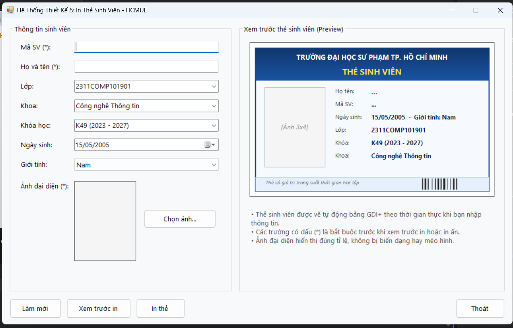

- **Mô tả:** Khi ứng dụng **StudentCardDesigner** khởi chạy, Form chính `FrmStudentCard` xuất hiện với giao diện hiện đại, rõ ràng, được chia làm 2 vùng làm việc riêng biệt (Split Layout):
  - **Vùng nhập liệu bên trái (`grpThongTin`):** Chứa các ô nhập liệu thông tin cá nhân của sinh viên, khu vực chọn ảnh đại diện và thanh điều khiển chức năng phía dưới.
  - **Vùng xem trước thẻ bên phải (`grpPreview`):** Chứa `Panel` hiển thị thẻ sinh viên được kết xuất động bằng công nghệ GDI+ theo thời gian thực.
- **Thiết lập mặc định ban đầu:**
  - Tiêu đề Form: `Hệ Thống Thiết Kế & In Thẻ Sinh Viên - HCMUE`, tự động căn giữa màn hình (`StartPosition = CenterScreen`), cố định kích thước (`FormBorderStyle = FixedSingle`, `MaximizeBox = false`).
  - Font chữ giao diện: `Segoe UI` chuẩn mực, đồng bộ kích thước hiển thị sắc nét.
  - Các giá trị mẫu mặc định:
    - `cboGioiTinh`: Mặc định chọn `Nam` (danh sách gồm *Nam*, *Nữ*, *Khác*).
    - `cboLop`: Mặc định chọn `2311COMP101901` (danh sách sẵn các lớp CNTT).
    - `cboKhoa`: Mặc định chọn `Công nghệ Thông tin` (danh sách các khoa thuộc HCMUE).
    - `cboKhoaHoc`: Mặc định chọn `K49 (2023 - 2027)`.
    - `dtpNgaySinh`: Định dạng ngày chuẩn Việt Nam `dd/MM/yyyy`, giá trị mặc định `15/05/2005`.
    - Khung ảnh `picAvatar`: Kích thước chuẩn thẻ 3x4 (120x155 px), chế độ `PictureBoxSizeMode.Zoom`.
  - Khung xem trước thẻ (`pnlPreview`): Tự động vẽ bản mẫu khung thẻ với thông tin mặc định, hiển thị placeholder `[Ảnh 3x4]` khi người dùng chưa chọn ảnh đại diện.

---

## 2. Nhập liệu & Cơ chế xem trước thẻ thời gian thực (Live Real-time Preview)

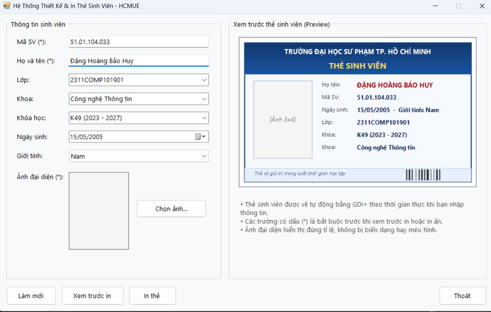

- **Cơ chế cập nhật thời gian thực (Live Preview):**
  - Mọi thao tác gõ phím trên `txtMaSV`, `txtHoTen`, lựa chọn giá trị trên `cboLop`, `cboKhoa`, `cboKhoaHoc`, `cboGioiTinh` hoặc chọn ngày trên `dtpNgaySinh` đều tự động kích hoạt lệnh vẽ lại:
  ```csharp
  private void RegisterEventHandlers()
  {
      txtMaSV.TextChanged += (s, e) => pnlPreview.Invalidate();
      txtHoTen.TextChanged += (s, e) => pnlPreview.Invalidate();
      cboLop.TextChanged += (s, e) => pnlPreview.Invalidate();
      cboLop.SelectedIndexChanged += (s, e) => pnlPreview.Invalidate();
      cboKhoa.TextChanged += (s, e) => pnlPreview.Invalidate();
      cboKhoa.SelectedIndexChanged += (s, e) => pnlPreview.Invalidate();
      cboKhoaHoc.TextChanged += (s, e) => pnlPreview.Invalidate();
      cboKhoaHoc.SelectedIndexChanged += (s, e) => pnlPreview.Invalidate();
      cboGioiTinh.SelectedIndexChanged += (s, e) => pnlPreview.Invalidate();
      dtpNgaySinh.ValueChanged += (s, e) => pnlPreview.Invalidate();
  }
  ```
- **Quy trình kết xuất đồ họa GDI+ trong sự kiện `Paint`:**
  - Đảm bảo tuân thủ nguyên tắc cốt lõi của đề bài: *Vẽ hoàn toàn bằng GDI+ trong sự kiện `Paint` của `Panel`*, không vẽ tạm bợ rồi bỏ qua dữ liệu.
  - Khi hệ điều hành phát tín hiệu vẽ lại (`pnlPreview_Paint`), hàm `DrawStudentCard(e.Graphics, cardRect)` được gọi để tính toán tọa độ và kết xuất toàn bộ thẻ sinh viên.

---

## 3. Xử lý ảnh đại diện & Thuật toán giữ đúng tỉ lệ gốc (Image Aspect Ratio & Non-blocking)

| Chọn ảnh qua OpenFileDialog | Hiển thị trong PictureBox & Thẻ xem trước (Không méo ảnh) |
| :---: | :---: |
| 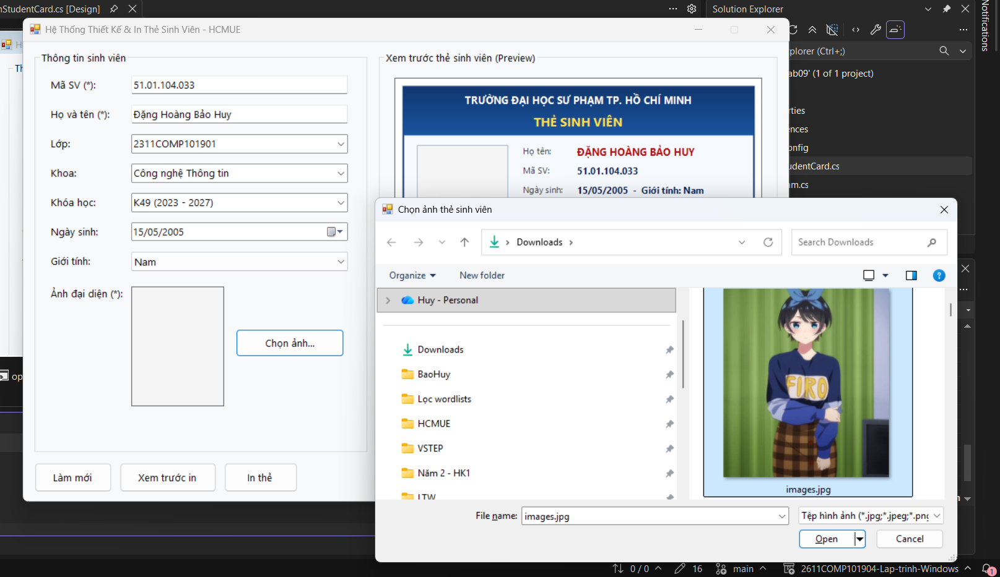 | 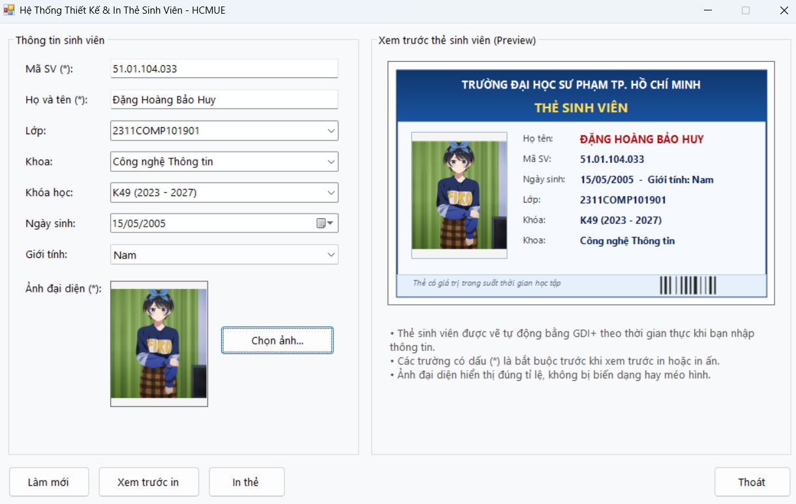 |

- **Chọn ảnh và nạp an toàn không khóa file (`btnChonAnh_Click`):**
  - Sử dụng `OpenFileDialog` với bộ lọc file nghiêm ngặt: `Tệp hình ảnh (*.jpg;*.jpeg;*.png;*.bmp)|*.jpg;*.jpeg;*.png;*.bmp|All files (*.*)|*.*`.
  - Thay vì gọi trực tiếp `Image.FromFile()` (vốn sẽ khóa file trên đĩa và gây lỗi sharing violation khi người dùng muốn đổi tên hoặc chỉnh sửa ảnh), chương trình đọc qua luồng `FileStream` và clone độc lập một đối tượng `Bitmap`:
  ```csharp
  using (FileStream fs = new FileStream(openFileDialog1.FileName, FileMode.Open, FileAccess.Read))
  using (Image temp = Image.FromStream(fs))
  {
      if (avatarImage != null)
      {
          avatarImage.Dispose();
          avatarImage = null;
      }
      avatarImage = new Bitmap(temp); // Clone ra bộ nhớ riêng
  }
  picAvatar.Image = avatarImage;
  pnlPreview.Invalidate();
  ```
- **Thuật toán bảo toàn tỉ lệ khung hình (Aspect Ratio Calculation):**
  - Để ảnh chân dung khi vẽ lên thẻ bằng GDI+ không bao giờ bị méo mó (bẹp ngang hoặc kéo dài), phương thức `DrawImageProportional` so sánh tỉ lệ giữa chiều rộng/chiều cao của ảnh gốc so với khung chứa:
  ```csharp
  private void DrawImageProportional(Graphics g, Image img, Rectangle targetRect)
  {
      if (img == null || targetRect.Width <= 0 || targetRect.Height <= 0) return;

      float imgAspect = (float)img.Width / img.Height;
      float targetAspect = (float)targetRect.Width / targetRect.Height;

      int drawWidth, drawHeight, drawX, drawY;

      if (imgAspect > targetAspect)
      {
          // Ảnh ngang hơn khung: căn chỉnh theo chiều rộng, tự động căn giữa theo chiều cao
          drawWidth = targetRect.Width;
          drawHeight = (int)(targetRect.Width / imgAspect);
          drawX = targetRect.X;
          drawY = targetRect.Y + (targetRect.Height - drawHeight) / 2;
      }
      else
      {
          // Ảnh dọc hơn khung: căn chỉnh theo chiều cao, tự động căn giữa theo chiều rộng
          drawHeight = targetRect.Height;
          drawWidth = (int)(targetRect.Height * imgAspect);
          drawX = targetRect.X + (targetRect.Width - drawWidth) / 2;
          drawY = targetRect.Y;
      }

      g.DrawImage(img, new Rectangle(drawX, drawY, drawWidth, drawHeight));
  }
  ```

---

## 4. Kiểm tra tính hợp lệ của dữ liệu (Validation & Error Handling)

| Cảnh báo thiếu Mã sinh viên | Cảnh báo thiếu Họ và tên | Cảnh báo chưa chọn Ảnh |
| :---: | :---: | :---: |
| 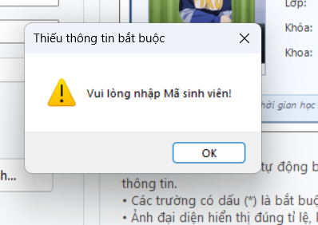 | 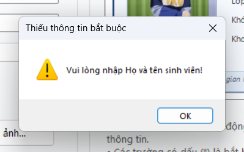 | 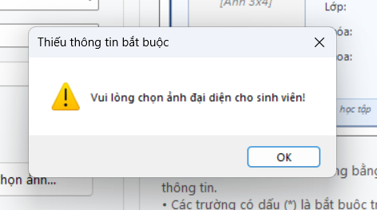 |

- **Quy tắc kiểm tra hợp lệ (`ValidateInput`):**
  - Ngăn chặn triệt để hành động xem trước in hoặc in thẻ khi chưa có đủ thông tin nhận diện cốt lõi.
  - Sử dụng `string.IsNullOrWhiteSpace()` để loại bỏ trường hợp người dùng chỉ gõ phím khoảng trắng (space).
  - Tự động di chuyển con trỏ chuột (`Focus()`) đến đúng trường bị thiếu để hỗ trợ người dùng nhập liệu nhanh chóng:
  ```csharp
  private bool ValidateInput()
  {
      if (string.IsNullOrWhiteSpace(txtMaSV.Text))
      {
          MessageBox.Show("Vui lòng nhập Mã sinh viên!", "Thiếu thông tin bắt buộc", MessageBoxButtons.OK, MessageBoxIcon.Warning);
          txtMaSV.Focus();
          return false;
      }
      if (string.IsNullOrWhiteSpace(txtHoTen.Text))
      {
          MessageBox.Show("Vui lòng nhập Họ và tên sinh viên!", "Thiếu thông tin bắt buộc", MessageBoxButtons.OK, MessageBoxIcon.Warning);
          txtHoTen.Focus();
          return false;
      }
      if (avatarImage == null)
      {
          MessageBox.Show("Vui lòng chọn ảnh đại diện cho sinh viên!", "Thiếu thông tin bắt buộc", MessageBoxButtons.OK, MessageBoxIcon.Warning);
          btnChonAnh.Focus();
          return false;
      }
      return true;
  }
  ```

---

## 5. Chức năng Xem trước bản in (Print Preview với PrintPreviewDialog)

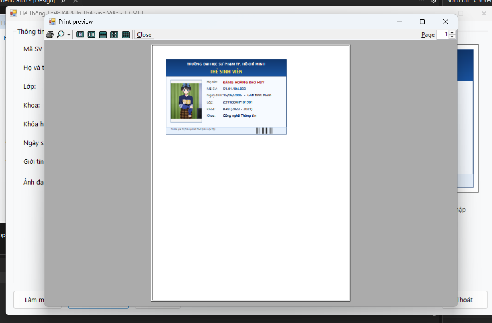

- **Mô tả:**
  - Nhấn nút **Xem trước in** (`btnXemTruoc_Click`), sau khi vượt qua bước kiểm tra `ValidateInput()`, hệ thống khởi tạo và mở hộp thoại chuẩn `PrintPreviewDialog`.
  - Cửa sổ xem trước in được tối ưu kích thước trực quan (Width: 850px, Height: 600px, StartPosition: CenterParent), cho phép phóng to, thu nhỏ, điều chỉnh số trang hiển thị trước khi quyết định in thực tế.
- **Cơ chế tái sử dụng hàm vẽ GDI+ (`DrawStudentCard`):**
  - Nội dung trang in được định nghĩa trong sự kiện `printDocument1_PrintPage`. Thay vì phải viết lại logic vẽ, sự kiện này tái sử dụng trực tiếp hàm `DrawStudentCard` với vùng in `printCardRect` kích thước tiêu chuẩn:
  ```csharp
  private void printDocument1_PrintPage(object sender, PrintPageEventArgs e)
  {
      Rectangle printCardRect = new Rectangle(60, 60, 520, 325);
      DrawStudentCard(e.Graphics, printCardRect);
      e.HasMorePages = false;
  }
  ```

---

## 6. Chức năng In thẻ qua máy in (PrintDialog & PrintDocument)

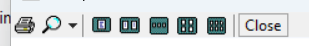

- **Mô tả:**
  - Nhấn nút **In thẻ** (`btnIn_Click`), chương trình mở hộp thoại `PrintDialog` (`UseEXDialog = true`) cho phép người dùng:
    - Lựa chọn máy in mong muốn (máy in nhiệt, máy in văn phòng hoặc máy in ảo *Microsoft Print to PDF*).
    - Thiết lập số lượng bản in, chất lượng bản in.
  - Khi người dùng xác nhận `DialogResult.OK`, lệnh `printDocument1.Print()` được kích hoạt, đồng thời hiển thị thông báo thành công. Toàn bộ quá trình được bọc trong khối `try...catch` để xử lý ngoại lệ khi máy in mất kết nối hoặc bị hủy lệnh.

---

## 7. Chức năng Làm mới (Reset Form) & Xác nhận Thoát an toàn

| Thao tác Làm mới toàn bộ Form | Hộp thoại xác nhận thoát an toàn |
| :---: | :---: |
| 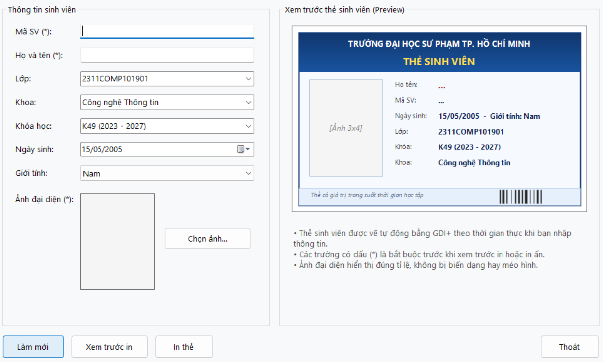 | 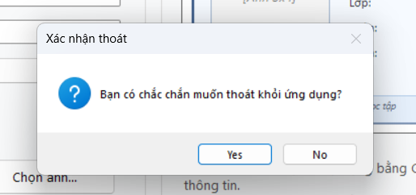 |

- **Làm mới dữ liệu (`btnLamMoi_Click`):**
  - Xóa trắng các ô nhập liệu `txtMaSV.Clear()`, `txtHoTen.Clear()`.
  - Đưa các `ComboBox` về chỉ số mặc định ban đầu.
  - Giải phóng hoàn toàn ảnh đại diện cũ trong bộ nhớ bằng `avatarImage.Dispose()`, đặt `picAvatar.Image = null`.
  - Gọi `pnlPreview.Invalidate()` để đưa thẻ sinh viên về trạng thái ban đầu, tự động focus về `txtMaSV`.
- **Thoát an toàn (`btnThoat_Click`):**
  - Hiển thị hộp thoại `MessageBox.Show` hai nút `Yes / No` cùng biểu tượng `MessageBoxIcon.Question`, ngăn chặn tình trạng người dùng vô tình bấm nhầm làm mất dữ liệu.

---

## 8. Các điểm mở rộng và thiết kế nâng cao (Advanced Features)
- **1. Banner tiêu đề chuyển màu Gradient chuyên nghiệp:**
  - Phần đầu thẻ được vẽ bằng `LinearGradientBrush` chuyển màu mượt mà từ xanh dương đậm (`RGB 16, 54, 110`) sang xanh tươi (`RGB 25, 84, 160`), tạo cảm giác trang trọng chuẩn thẻ sinh viên đại học.
  - Tiêu đề tên trường màu trắng sắc nét kết hợp dòng chữ `THẺ SINH VIÊN` màu vàng ánh kim (`RGB 255, 223, 80`).
- **2. Khử răng cưa và làm mịn nét chữ tối đa:**
  - Kích hoạt chế độ `SmoothingMode.AntiAlias`, `TextRenderingHint.ClearTypeGridFit` và `InterpolationMode.HighQualityBicubic` đảm bảo cả khi xem preview trên màn hình lẫn khi xuất ra máy in giấy/PDF đều đạt độ sắc nét tuyệt đối.
- **3. Mã vạch Barcode giả lập bằng GDI+ (`DrawMockBarcode`):**
  - Tự động vẽ một dải mã vạch sinh viên chuyên nghiệp ở góc dưới bên phải thẻ bằng các dải chữ nhật có độ rộng so le, tăng tính thẩm mỹ và mô phỏng thực tế thẻ định danh hiện đại.
- **4. Dải Footer trang trí:**
  - Bổ sung dải phân cách màu xanh nhạt cùng dòng ghi chú xác nhận giá trị thẻ: *"Thẻ có giá trị trong suốt thời gian học tập"*.

---

## 9. Cấu trúc mã nguồn & Tối ưu hóa hiệu năng GDI+

### Bảng phân bố tệp tin và vai trò

| Tệp tin | Thư mục | Vai trò trong hệ thống |
| :--- | :--- | :--- |
| `FrmStudentCard.cs` | `Lab09/` | Chứa toàn bộ logic xử lý sự kiện, thuật toán kiểm tra dữ liệu và hàm vẽ GDI+ (`DrawStudentCard`, `DrawImageProportional`, `DrawMockBarcode`) |
| `FrmStudentCard.Designer.cs` | `Lab09/` | Thiết kế bố cục giao diện trực quan 2 vùng (Nhập liệu & Preview), khai báo các thành phần WinForms |
| `Program.cs` | `Lab09/` | Điểm khởi chạy ứng dụng Windows Forms (`Application.Run(new FrmStudentCard())`) |
| `Lab09.csproj` & `Lab09.slnx` | `Lab09/` | Tệp cấu hình dự án .NET Framework 4.7.2 và giải pháp Visual Studio |
| `App.config` | `Lab09/` | Cấu hình thời gian chạy của ứng dụng .NET |
| `README.md` | `Lab09/` | Báo cáo chi tiết kết quả thực hành, hướng dẫn chạy và bảng kiểm thử |
| `.gitignore` | `Lab09/` | Loại trừ các file rác build (`.vs`, `bin`, `obj`) khi đồng bộ Git |

### Kỹ thuật tối ưu hóa & Quản lý bộ nhớ:
- **Giải phóng tài nguyên GDI+ an toàn (Resource Cleanup):**
  - Mọi đối tượng đồ họa unmanaged như `SolidBrush`, `LinearGradientBrush`, `Pen`, `Font`, `StringFormat` đều được bao bọc chặt chẽ trong khối lệnh `using (...)` để tự động kích hoạt `Dispose()` giải phóng tài nguyên hệ điều hành ngay khi vẽ xong, loại bỏ hoàn toàn nguy cơ rò rỉ bộ nhớ (Memory Leak).
- **Quản lý vòng đời ảnh đại diện (`avatarImage`):**
  - Khi người dùng đổi ảnh mới hoặc bấm làm mới, đối tượng ảnh cũ luôn được `Dispose()` trước khi gán mới. Khi đóng Form (`Dispose(bool disposing)`), ảnh đại diện cũng được giải phóng dứt điểm.
- **Trải nghiệm nhập liệu tiện lợi (UX):**
  - Phím tắt Enter mặc định, thứ tự Tab index được đánh số tuần tự khoa học từ trên xuống dưới, từ trái qua phải.

---

## 10. Hướng dẫn biên dịch và chạy chương trình

### Cách 1: Sử dụng Visual Studio (Khuyên dùng)
1. Khởi động Visual Studio 2019 / 2022.
2. Mở file giải pháp `Lab09\Lab09.slnx` hoặc file project `Lab09\Lab09\Lab09.csproj`.
3. Nhấn **F5** hoặc bấm nút **Start** trên thanh công cụ để biên dịch và chạy chương trình.

### Cách 2: Chạy trực tiếp file thực thi (.exe)
Truy cập thư mục đầu ra của bản dựng:
`Lab09\Lab09\bin\Debug\Lab09.exe`
và nhấp đúp chuột để chạy trực tiếp ứng dụng mà không cần mở môi trường lập trình.

### Cách 3: Biên dịch qua dòng lệnh (MSBuild)
Mở cửa sổ PowerShell tại thư mục dự án và thực thi lệnh:
```powershell
& "C:\Program Files\Microsoft Visual Studio\18\Community\MSBuild\Current\Bin\MSBuild.exe" Lab09.csproj /t:Build /p:Configuration=Debug
.\bin\Debug\Lab09.exe
```
