# BÁO CÁO KẾT QUẢ THỰC HÀNH LAB 10
**Học phần:** COMP1019 - Lập trình trên Windows  
**Đề tài:** Thiết kế và cài đặt cơ sở dữ liệu EduManagerDB bằng SQL Server  
**Sinh viên thực hiện:** Đặng Hoàng Bảo Huy | **MSSV:** 51.01.104.033 | **Lớp:** 51.01.CNTT.C  

---

## 1. Giới thiệu & Thiết kế lược đồ cơ sở dữ liệu (Database Schema)

Cơ sở dữ liệu `EduManagerDB` được thiết kế nhằm phục vụ cho hệ thống quản trị học vụ và quản lý sinh viên. Hệ thống được chuẩn hóa ở dạng quan hệ, bao gồm 6 bảng dữ liệu với đầy đủ các ràng buộc toàn vẹn khóa chính (Primary Key), khóa ngoại (Foreign Key) và ràng buộc miền giá trị (CHECK Constraint).

### 1.1. Sơ đồ thực thể quan hệ (ERD)

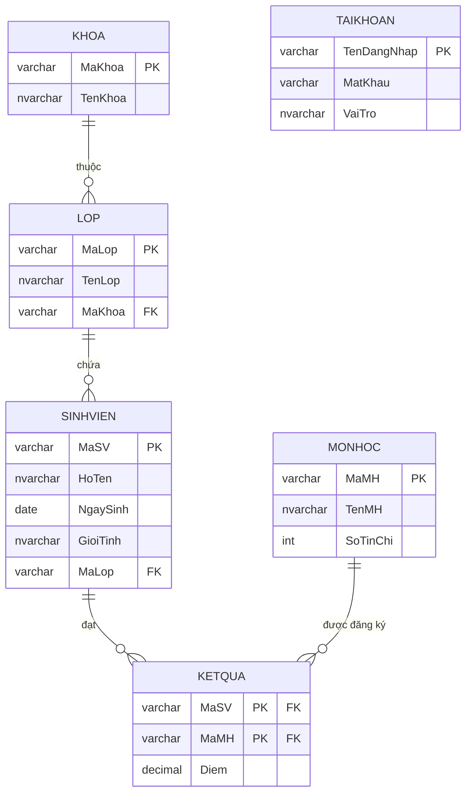

### 1.2. Danh sách bảng và ràng buộc toàn vẹn

| Tên Bảng | Khóa chính (PK) | Khóa ngoại (FK) | Ràng buộc nghiệp vụ (CHECK) | Mục đích lưu trữ |
| :--- | :--- | :--- | :--- | :--- |
| **KHOA** | `MaKhoa` | *(Không)* | *(Không)* | Lưu danh mục các khoa trong trường |
| **LOP** | `MaLop` | `MaKhoa` $\rightarrow$ `KHOA(MaKhoa)` | *(Không)* | Lưu các lớp thuộc khoa |
| **SINHVIEN** | `MaSV` | `MaLop` $\rightarrow$ `LOP(MaLop)` | `GioiTinh IN (N'Nam', N'Nữ')` | Lưu hồ sơ sinh viên |
| **MONHOC** | `MaMH` | *(Không)* | `SoTinChi > 0` | Lưu thông tin môn học và số tín chỉ |
| **KETQUA** | `(MaSV, MaMH)` | `MaSV` $\rightarrow$ `SINHVIEN`<br>`MaMH` $\rightarrow$ `MONHOC` | `Diem >= 0.0 AND Diem <= 10.0` | Lưu kết quả điểm thi từng môn của sinh viên |
| **TAIKHOAN** | `TenDangNhap` | *(Không)* | `VaiTro IN (N'Admin', N'Giảng viên', N'Sinh viên')` | Lưu tài khoản đăng nhập demo và phân quyền |

---

## 2. Cấu trúc mã nguồn & Quy trình thực thi

Bài thực hành được tổ chức thành 3 tập tin kịch bản T-SQL độc lập, theo đúng thứ tự logic đảm bảo toàn vẹn dữ liệu:

1. **`01_CreateDatabase.sql`**: Xóa kết nối cũ, khởi tạo CSDL `EduManagerDB`, tạo 6 bảng cùng toàn bộ khóa chính, khóa ngoại và ràng buộc `CHECK`.
2. **`02_InsertSampleData.sql`**: Nạp dữ liệu mẫu đạt và vượt định mức tối thiểu: 2 khoa, 3 lớp, 7 sinh viên (thừa 1 SV chưa có điểm để kiểm thử câu xóa), 4 môn học, 11 bản ghi điểm, 3 tài khoản.
3. **`03_Queries.sql`**: Thực thi 12 câu truy vấn theo đúng thứ tự đề bài yêu cầu, bao gồm các câu `JOIN`, `GROUP BY`, `HAVING`, `UPDATE`, `DELETE` và kiểm thử vi phạm ràng buộc có bọc khối `TRY...CATCH`.

---

## 3. Chi tiết thực thi & Kết quả 12 câu truy vấn

### Truy vấn 1: Liệt kê toàn bộ sinh viên
- **Mục đích:** Kiểm tra thông tin tất cả sinh viên hiện có trong hệ thống.
- **T-SQL:**
  ```sql
  SELECT 
      sv.MaSV AS [Mã Sinh Viên],
      sv.HoTen AS [Họ và Tên],
      CONVERT(VARCHAR(10), sv.NgaySinh, 103) AS [Ngày Sinh],
      sv.GioiTinh AS [Giới Tính],
      sv.MaLop AS [Mã Lớp]
  FROM SINHVIEN sv;
  ```
- **Ảnh chụp kết quả minh chứng:**
  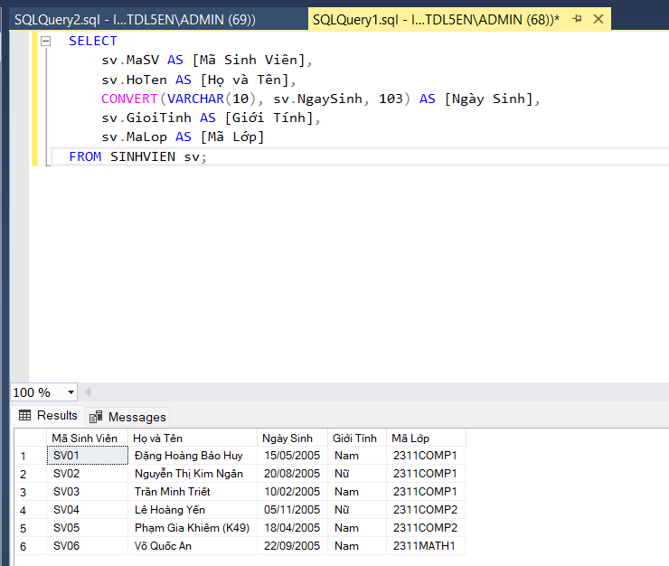

---

### Truy vấn 2: Liệt kê sinh viên kèm tên lớp và tên khoa
- **Mục đích:** Kết nối 3 bảng `SINHVIEN`, `LOP`, `KHOA` thông qua các khóa ngoại tương ứng.
- **T-SQL:**
  ```sql
  SELECT 
      sv.MaSV AS [Mã SV],
      sv.HoTen AS [Họ Tên Sinh Viên],
      sv.GioiTinh AS [Giới Tính],
      l.TenLop AS [Tên Lớp],
      k.TenKhoa AS [Thuộc Khoa]
  FROM SINHVIEN sv
  INNER JOIN LOP l ON sv.MaLop = l.MaLop
  INNER JOIN KHOA k ON l.MaKhoa = k.MaKhoa;
  ```
- **Ảnh chụp kết quả minh chứng:**
  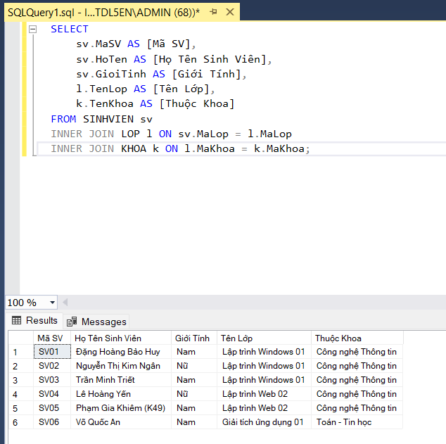

---

### Truy vấn 3: Tìm sinh viên theo một phần họ tên bằng `LIKE`
- **Mục đích:** Tìm kiếm gần đúng với chuỗi ký tự Unicode có dấu (sử dụng tiền tố `N`).
- **T-SQL:**
  ```sql
  SELECT sv.MaSV, sv.HoTen, sv.GioiTinh, sv.MaLop
  FROM SINHVIEN sv
  WHERE sv.HoTen LIKE N'%Huy%';
  ```
- **Ảnh chụp kết quả minh chứng:**
  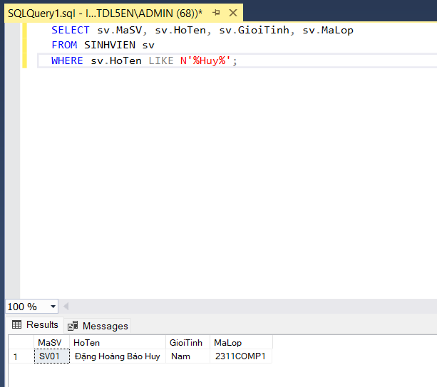

---

### Truy vấn 4: Liệt kê sinh viên theo mã lớp
- **Mục đích:** Lọc danh sách sinh viên thuộc lớp `2311COMP1`.
- **T-SQL:**
  ```sql
  SELECT sv.MaSV, sv.HoTen, sv.GioiTinh, CONVERT(VARCHAR(10), sv.NgaySinh, 103) AS [Ngày Sinh], sv.MaLop
  FROM SINHVIEN sv
  WHERE sv.MaLop = '2311COMP1';
  ```
- **Ảnh chụp kết quả minh chứng:**
  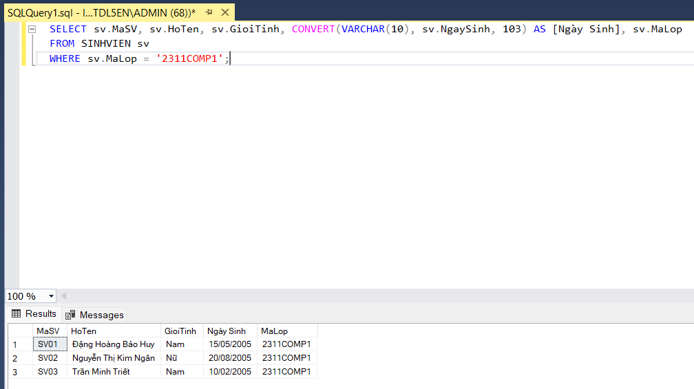

---

### Truy vấn 5: Cập nhật họ tên hoặc lớp của một sinh viên
- **Mục đích:** Cập nhật thông tin sinh viên `SV05` với cơ chế kiểm tra trước và sau khi cập nhật.
- **T-SQL:**
  ```sql
  -- Cập nhật họ tên của SV05
  UPDATE SINHVIEN
  SET HoTen = N'Phạm Gia Khiêm (K49)'
  WHERE MaSV = 'SV05';
  ```
- **Ảnh chụp kết quả minh chứng:**
  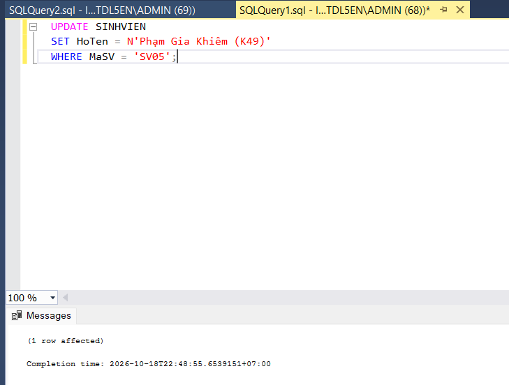

---

### Truy vấn 6: Xóa một sinh viên chưa có dữ liệu điểm
- **Mục đích:** Xóa an toàn sinh viên `SV07` (chưa phát sinh điểm trong bảng `KETQUA`), đảm bảo không vi phạm ràng buộc toàn vẹn tham chiếu.
- **T-SQL:**
  ```sql
  DELETE FROM SINHVIEN
  WHERE MaSV = 'SV07'
    AND MaSV NOT IN (SELECT DISTINCT MaSV FROM KETQUA);
  ```
- **Ảnh chụp kết quả minh chứng:**
  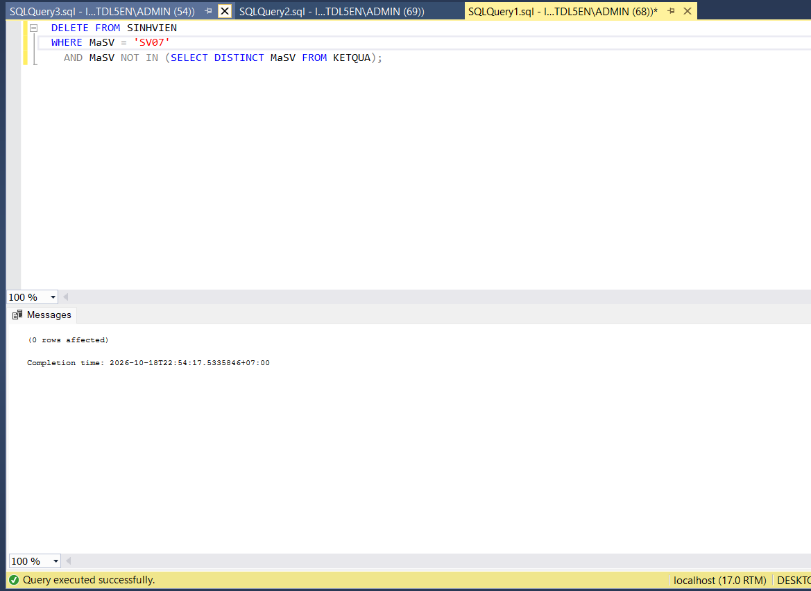

---

### Truy vấn 7: Liệt kê điểm của từng sinh viên theo từng môn
- **Mục đích:** Kết nối bảng `KETQUA` với `SINHVIEN` và `MONHOC` để xem chi tiết học tập.
- **T-SQL:**
  ```sql
  SELECT 
      sv.MaSV AS [Mã SV],
      sv.HoTen AS [Họ Tên Sinh Viên],
      mh.MaMH AS [Mã Môn],
      mh.TenMH AS [Tên Môn Học],
      mh.SoTinChi AS [Số Tín Chỉ],
      kq.Diem AS [Điểm]
  FROM KETQUA kq
  INNER JOIN SINHVIEN sv ON kq.MaSV = sv.MaSV
  INNER JOIN MONHOC mh ON kq.MaMH = mh.MaMH
  ORDER BY sv.MaSV ASC, mh.MaMH ASC;
  ```
- **Ảnh chụp kết quả minh chứng:**
  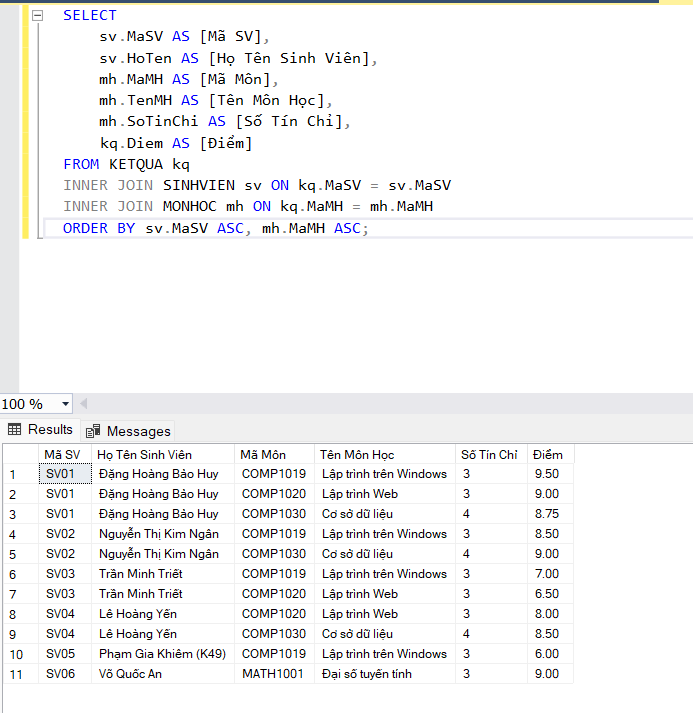

---

### Truy vấn 8: Tính điểm trung bình của từng sinh viên
- **Mục đích:** Gom nhóm theo sinh viên, sử dụng hàm tổng hợp `AVG(Diem)` và làm tròn 2 chữ số thập phân (`CAST(... AS DECIMAL(4, 2))`), sắp xếp theo thứ hạng ĐTB giảm dần.
- **T-SQL:**
  ```sql
  SELECT 
      sv.MaSV AS [Mã SV],
      sv.HoTen AS [Họ Tên Sinh Viên],
      COUNT(kq.MaMH) AS [Số Môn Đã Học],
      CAST(AVG(kq.Diem) AS DECIMAL(4, 2)) AS [Điểm Trung Bình]
  FROM SINHVIEN sv
  INNER JOIN KETQUA kq ON sv.MaSV = kq.MaSV
  GROUP BY sv.MaSV, sv.HoTen
  ORDER BY [Điểm Trung Bình] DESC;
  ```
- **Kết quả trả về:**
  | Mã SV | Họ Tên Sinh Viên | Số Môn Đã Học | Điểm Trung Bình |
  | :--- | :--- | :---: | :---: |
  | **SV01** | Đặng Hoàng Bảo Huy | 3 | **9.08** |
  | **SV06** | Võ Quốc An | 1 | **9.00** |
  | **SV02** | Nguyễn Thị Kim Ngân | 2 | **8.75** |
  | **SV04** | Lê Hoàng Yến | 2 | **8.25** |
  | **SV03** | Trần Minh Triết | 2 | **6.75** |
  | **SV05** | Phạm Gia Khiêm (K49) | 1 | **6.00** |
- **Ảnh chụp kết quả minh chứng:**
  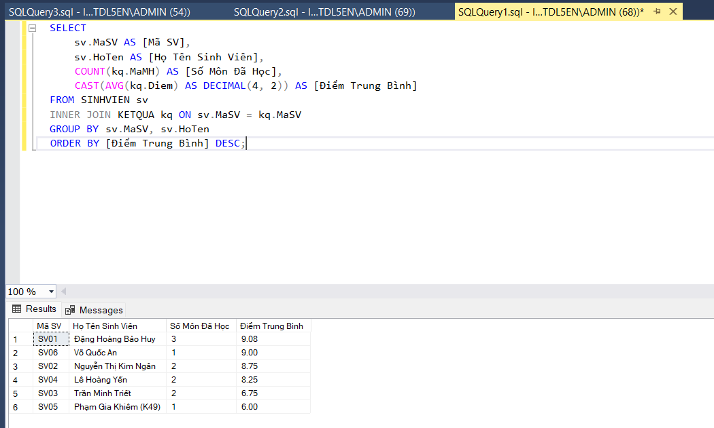

---

### Truy vấn 9: Thống kê số sinh viên theo từng lớp
- **Mục đích:** Gom nhóm theo từng lớp học, sử dụng `LEFT JOIN` với bảng `SINHVIEN` để các lớp chưa có sinh viên vẫn hiển thị số lượng bằng 0.
- **T-SQL:**
  ```sql
  SELECT 
      l.MaLop AS [Mã Lớp],
      l.TenLop AS [Tên Lớp],
      k.TenKhoa AS [Khoa],
      COUNT(sv.MaSV) AS [Số Lượng Sinh Viên]
  FROM LOP l
  INNER JOIN KHOA k ON l.MaKhoa = k.MaKhoa
  LEFT JOIN SINHVIEN sv ON l.MaLop = sv.MaLop
  GROUP BY l.MaLop, l.TenLop, k.TenKhoa
  ORDER BY [Số Lượng Sinh Viên] DESC;
  ```
- **Ảnh chụp kết quả minh chứng:**
  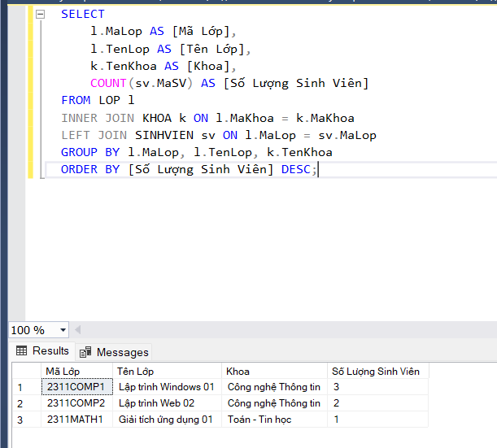

---

### Truy vấn 10: Liệt kê các lớp có từ 2 sinh viên trở lên
- **Mục đích:** Sử dụng mệnh đề `HAVING COUNT(sv.MaSV) >= 2` sau khi gom nhóm.
- **T-SQL:**
  ```sql
  SELECT 
      l.MaLop AS [Mã Lớp],
      l.TenLop AS [Tên Lớp],
      COUNT(sv.MaSV) AS [Số Lượng Sinh Viên]
  FROM LOP l
  INNER JOIN SINHVIEN sv ON l.MaLop = sv.MaLop
  GROUP BY l.MaLop, l.TenLop
  HAVING COUNT(sv.MaSV) >= 2
  ORDER BY [Số Lượng Sinh Viên] DESC;
  ```
- **Kết quả trả về:** Lớp `2311COMP1` (3 SV) và `2311COMP2` (2 SV) được hiển thị; lớp `2311MATH1` (1 SV) bị loại trừ chính xác.
- **Ảnh chụp kết quả minh chứng:**
  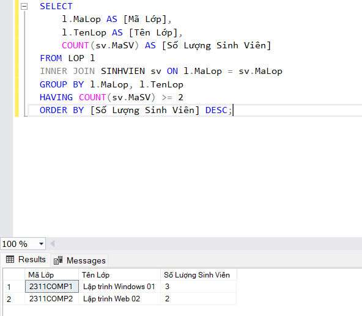

---

### Truy vấn 11: Kiểm thử lỗi thêm sinh viên vào lớp không tồn tại
- **Mục đích:** Chứng minh cơ chế bảo vệ của ràng buộc Khóa Ngoại (`FK_SINHVIEN_LOP`).
- **T-SQL:**
  ```sql
  BEGIN TRY
      INSERT INTO SINHVIEN (MaSV, HoTen, NgaySinh, GioiTinh, MaLop)
      VALUES ('SV99', N'Nguyễn Thất Bại', '2005-01-01', N'Nam', 'LOP_NONE');
  END TRY
  BEGIN CATCH
      PRINT N'[THÀNH CÔNG] Đã bắt được vi phạm ràng buộc Khóa Ngoại (Foreign Key)!';
      PRINT N'- Mã lỗi (Error Number): ' + CAST(ERROR_NUMBER() AS NVARCHAR(10));
      PRINT N'- Tên ràng buộc / Chi tiết: ' + ERROR_MESSAGE();
  END CATCH;
  ```
- **Kết quả bắt lỗi:**
  - `Mã lỗi (Error Number): 547`
  - `Thông báo: The INSERT statement conflicted with the FOREIGN KEY constraint "FK_SINHVIEN_LOP". The conflict occurred in database "EduManagerDB", table "dbo.LOP", column 'MaLop'.`
- **Ảnh chụp kết quả minh chứng:**
  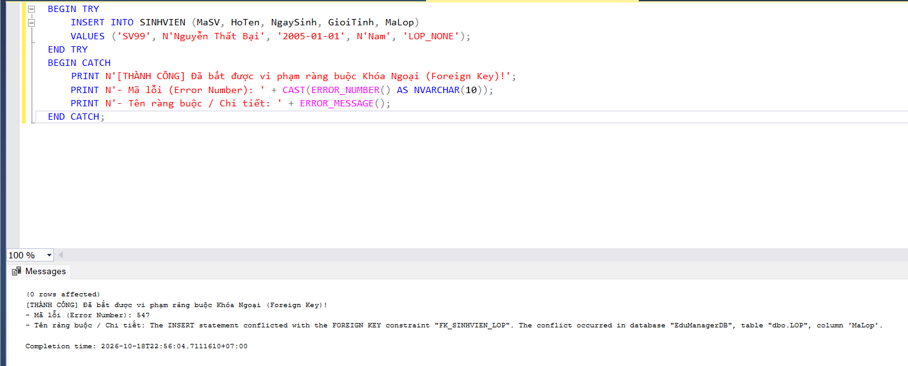

---

### Truy vấn 12: Kiểm thử lỗi khi nhập điểm ngoài khoảng 0 đến 10
- **Mục đích:** Chứng minh cơ chế bảo vệ của ràng buộc miền giá trị `CHECK (Diem >= 0.0 AND Diem <= 10.0)`.
- **T-SQL:**
  ```sql
  BEGIN TRY
      INSERT INTO KETQUA (MaSV, MaMH, Diem)
      VALUES ('SV01', 'MATH1001', 10.5);
  END TRY
  BEGIN CATCH
      PRINT N'[THÀNH CÔNG] Đã bắt được vi phạm ràng buộc CHECK điểm số!';
      PRINT N'- Mã lỗi (Error Number): ' + CAST(ERROR_NUMBER() AS NVARCHAR(10));
      PRINT N'- Tên ràng buộc / Chi tiết: ' + ERROR_MESSAGE();
  END CATCH;
  ```
- **Kết quả bắt lỗi:**
  - `Mã lỗi (Error Number): 547`
  - `Thông báo: The INSERT statement conflicted with the CHECK constraint "CK_KETQUA_Diem". The conflict occurred in database "EduManagerDB", table "dbo.KETQUA", column 'Diem'.`
- **Ảnh chụp kết quả minh chứng:**
  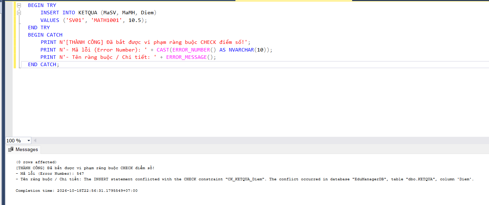

---

