# BÁO CÁO KẾT QUẢ THỰC HÀNH LAB 11
**Học phần:** COMP1019 - Lập trình trên Windows  
**Đề tài:** ADO.NET và CRUD với SQL Server (Quản lý Lớp học - EduManagerDB)  
**Giảng viên:** ThS. Lê Thanh Thoại  
**Sinh viên thực hiện:** Đặng Hoàng Bảo Huy | **MSSV:** 51.01.104.033 | **Lớp:** 51.01.CNTT.C  

---

## 1. Tổng quan & Thiết lập kết nối SQL Server (Environment & Connection String)

### Bảng thông tin môi trường thực thi

| Mục | Chi tiết |
| :--- | :--- |
| **Hệ điều hành** | Windows 11 Pro 64-bit |
| **Công cụ phát triển** | Visual Studio Community, MSBuild 18.x |
| **Nền tảng mục tiêu** | .NET Framework 4.7.2 (Windows Forms App) |
| **Hệ quản trị CSDL** | Microsoft SQL Server (Local instance: `localhost` / `DESKTOP-ATDL5EN`) |
| **Thư viện ADO.NET** | **`Microsoft.Data.SqlClient` (v5.2.2)** qua NuGet PackageReference |
| **Cơ sở dữ liệu** | `EduManagerDB` (Bảng `KHOA`, `LOP`, `SINHVIEN`) |
| **Mã nguồn chính** | [`Lab11/FrmLop.cs`](Lab11/FrmLop.cs) & [`Lab11/FrmLop.Designer.cs`](Lab11/FrmLop.Designer.cs) |
| **Script CSDL & Dữ liệu** | [`01_EduManagerDB.sql`](01_EduManagerDB.sql) |

### Cấu hình chuỗi kết nối (Connection String)

Ứng dụng cấu hình chuỗi kết nối trong file [`Lab11/App.config`](Lab11/App.config) theo chuẩn công nghiệp, đồng thời có cơ chế fallback trong mã nguồn [`Lab11/FrmLop.cs`](Lab11/FrmLop.cs):

```xml
<configuration>
    <connectionStrings>
        <add name="EduManagerDB" 
             connectionString="Server=localhost;Database=EduManagerDB;Integrated Security=True;TrustServerCertificate=True;" 
             providerName="Microsoft.Data.SqlClient" />
    </connectionStrings>
</configuration>
```

Đọc cấu hình trong mã nguồn C#:
```csharp
private readonly string _connectionString =
    ConfigurationManager.ConnectionStrings["EduManagerDB"]?.ConnectionString
    ?? @"Server=localhost;Database=EduManagerDB;Integrated Security=True;TrustServerCertificate=True;";
```

- `Server=localhost`: Kết nối trực tiếp đến SQL Server trên máy cục bộ.
- `Integrated Security=True`: Xác thực bằng Windows Authentication an toàn, không lưu mật khẩu dạng plaintext.
- `TrustServerCertificate=True`: Yêu cầu bắt buộc của `Microsoft.Data.SqlClient` v5+ trên môi trường dev local không cài SSL server certificate.

---

## 2. Giao diện ứng dụng & Khởi tạo dữ liệu (Form Load & Data Binding)

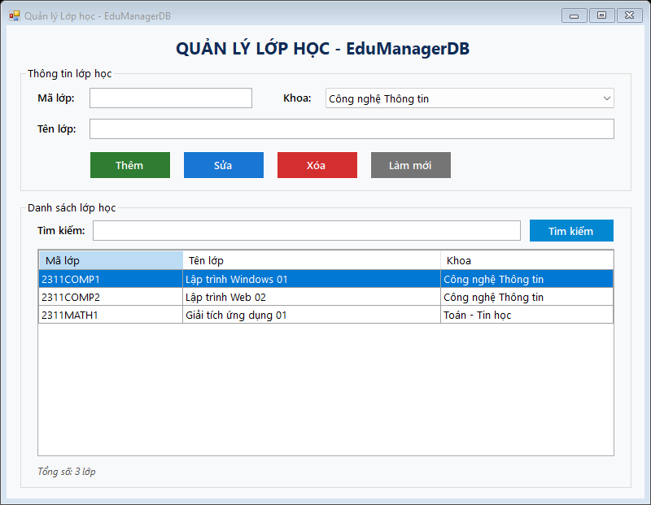

- **Bố cục giao diện chia 2 vùng làm việc trực quan:**
  - **Vùng nhập liệu bên trên (`grpThongTin`):** Chứa các ô nhập liệu Mã lớp (`txtMaLop`), Tên lớp (`txtTenLop`), ComboBox chọn Khoa (`cboKhoa`) và 4 nút chức năng CRUD.
  - **Vùng danh sách bên dưới (`grpDanhSach`):** Chứa thanh tìm kiếm (`txtTimKiem`, `btnTimKiem`), bảng `dgvLop` hiển thị danh sách lớp và nhãn đếm tổng số lớp (`lblTongSo`).
- **Quy trình nạp dữ liệu khi mở Form (`FrmLop_Load`):**
  - Tự động gọi `LoadKhoa()` nạp danh sách Khoa từ bảng `KHOA` vào `cboKhoa` (`DisplayMember = "TenKhoa"`, `ValueMember = "MaKhoa"`).
  - Tự động gọi `LoadData()` nạp toàn bộ danh sách lớp học từ SQL Server lên `dgvLop`.

```csharp
internal void LoadData()
{
    using (var conn = new SqlConnection(_connectionString))
    {
        conn.Open();
        string sql = @"SELECT L.MaLop, L.TenLop, K.TenKhoa, L.MaKhoa 
                       FROM LOP L 
                       LEFT JOIN KHOA K ON L.MaKhoa = K.MaKhoa 
                       ORDER BY L.MaLop";
        using (var da = new SqlDataAdapter(sql, conn))
        {
            var dt = new DataTable();
            da.Fill(dt);
            dgvLop.DataSource = dt;
            lblTongSo.Text = $"Tổng số: {dt.Rows.Count} lớp";
        }
    }
}
```

---

## 3. Tương tác chọn dòng trên DataGridView (CellClick Event)

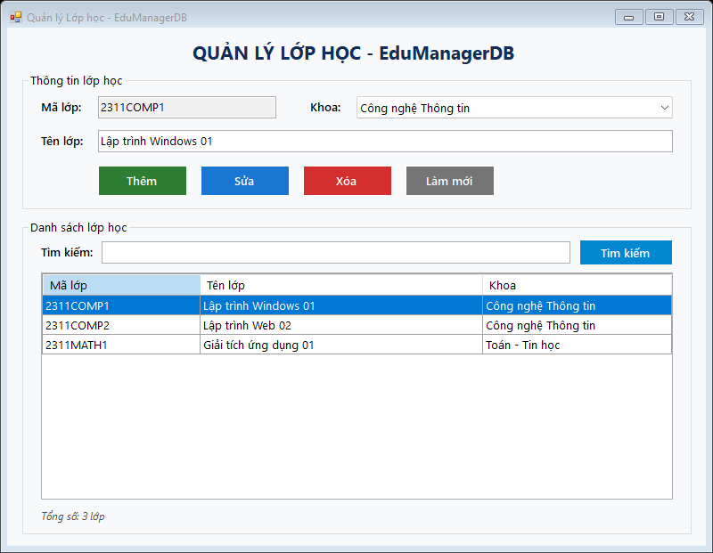

- **Mô tả:** Khi người dùng nhấp chọn một dòng trên `dgvLop`, sự kiện `dgvLop_CellClick` được kích hoạt:
  - Lấy giá trị các cột `colMaLop`, `colTenLop`, `colMaKhoa` của dòng đang chọn.
  - Đổ dữ liệu tương ứng lên `txtMaLop`, `txtTenLop` và thiết lập `cboKhoa.SelectedValue`.
  - Khóa ô `txtMaLop.ReadOnly = true` nhằm bảo vệ khóa chính, ngăn ngừa việc người dùng vô tình chỉnh sửa mã lớp khi đang thực hiện thao tác cập nhật tên lớp.

```csharp
private void dgvLop_CellClick(object sender, DataGridViewCellEventArgs e)
{
    if (e.RowIndex >= 0 && e.RowIndex < dgvLop.Rows.Count)
    {
        var row = dgvLop.Rows[e.RowIndex];
        txtMaLop.Text = row.Cells["colMaLop"].Value?.ToString() ?? "";
        txtTenLop.Text = row.Cells["colTenLop"].Value?.ToString() ?? "";

        if (row.Cells["colMaKhoa"].Value != null)
        {
            cboKhoa.SelectedValue = row.Cells["colMaKhoa"].Value.ToString();
        }

        txtMaLop.ReadOnly = true;
    }
}
```

---

## 4. Chức năng Thêm lớp học mới (Insert with Parameter & Duplicate Check)

| Bước 1: Nhập dữ liệu lớp mới | Bước 2: Thông báo & Cập nhật Grid (Tổng số: 4 lớp) |
| :---: | :---: |
|  | 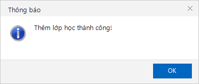<br>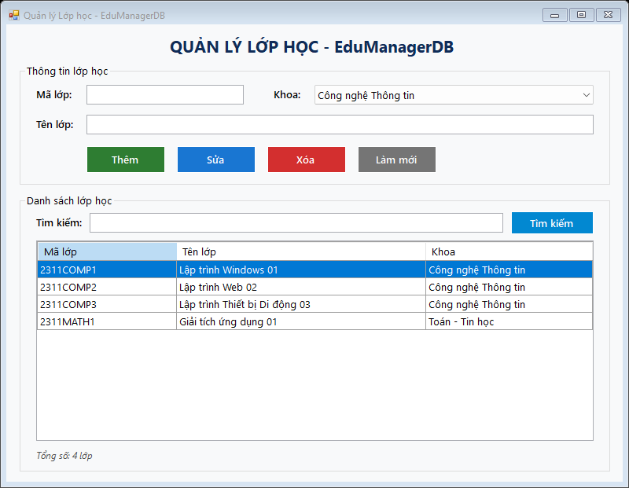 |

- **Quy trình thực thi nút Thêm (`btnThem_Click`):**
  1. Kiểm tra tính hợp lệ dữ liệu qua `ValidateInput(isAdding: true)` (không để trống mã, tên lớp và phải chọn khoa).
  2. Kiểm tra trùng khóa chính trong CSDL qua hàm `IsMaLopExists(maLop)`:
     ```csharp
     private bool IsMaLopExists(string maLop)
     {
         using (var conn = new SqlConnection(_connectionString))
         {
             conn.Open();
             string sql = "SELECT COUNT(*) FROM LOP WHERE MaLop = @MaLop";
             using (var cmd = new SqlCommand(sql, conn))
             {
                 cmd.Parameters.AddWithValue("@MaLop", maLop);
                 return Convert.ToInt32(cmd.ExecuteScalar()) > 0;
             }
         }
     }
     ```
  3. Thực thi câu lệnh `INSERT` có tham số hóa `SqlParameter`.
  4. Hiển thị thông báo thêm thành công, xóa trắng các trường nhập và nạp lại dữ liệu mới nhất lên `dgvLop`.

---

## 5. Chức năng Cập nhật thông tin lớp học (Update Operation)

| Thông báo cập nhật thành công | Kết quả hiển thị tên lớp mới trên DataGridView |
| :---: | :---: |
| 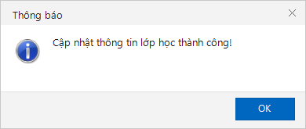 | 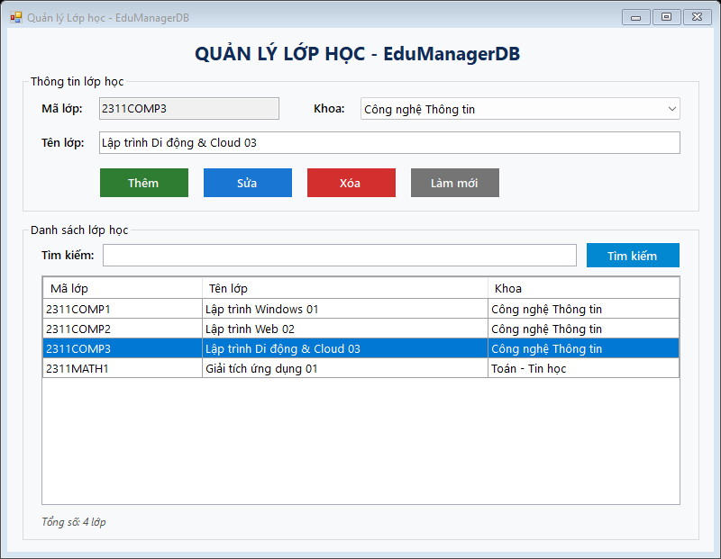 |

- **Quy trình thực thi nút Sửa (`btnSua_Click`):**
  1. Kiểm tra người dùng đã chọn một lớp từ danh sách hay chưa (`txtMaLop` không rỗng và đang ở chế độ `ReadOnly`).
  2. Kiểm tra hợp lệ dữ liệu tên lớp qua `ValidateInput(isAdding: false)`.
  3. Thực thi câu lệnh `UPDATE` tham số hóa:
     ```csharp
     using (var conn = new SqlConnection(_connectionString))
     {
         conn.Open();
         string sql = "UPDATE LOP SET TenLop = @TenLop, MaKhoa = @MaKhoa WHERE MaLop = @MaLop";
         using (var cmd = new SqlCommand(sql, conn))
         {
             cmd.Parameters.AddWithValue("@TenLop", txtTenLop.Text.Trim());
             cmd.Parameters.AddWithValue("@MaKhoa", cboKhoa.SelectedValue.ToString());
             cmd.Parameters.AddWithValue("@MaLop", txtMaLop.Text.Trim());
             cmd.ExecuteNonQuery();
         }
     }
     ```
  4. Cập nhật thông báo và nạp lại dữ liệu hiển thị trên Grid.

---

## 6. Chức năng Xóa lớp học & Xử lý ràng buộc khóa ngoại (FK Constraint Handling)

| Tình huống 1: Xóa lớp có SV (`2311COMP1`) → Bắt lỗi FK | Tình huống 2: Xóa lớp không có SV (`2311COMP3`) → Thành công |
| :--- | :--- |
| 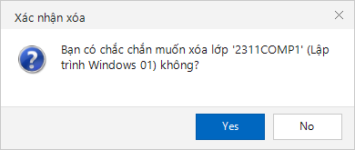<br>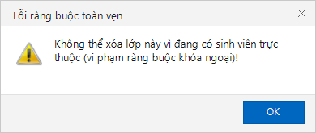 | <br> |

- **Xác nhận trước khi xóa:** Luôn mở hộp thoại xác nhận `MessageBoxButtons.YesNo` hỏi rõ mã và tên lớp cần xóa để tránh thao tác nhầm.
- **Xử lý ràng buộc khóa ngoại (Foreign Key Violation):**
  - Trong CSDL `EduManagerDB`, bảng `SINHVIEN` có khóa ngoại `MaLop` tham chiếu đến `LOP(MaLop)`.
  - Khi cố gắng xóa một lớp đang có sinh viên (ví dụ `2311COMP1`), SQL Server sẽ phát sinh lỗi vi phạm toàn vẹn dữ liệu với mã lỗi **547**.
  - Chương trình đón bắt ngoại lệ bằng cú pháp `catch (SqlException ex) when (ex.Number == 547)`, hiển thị thông báo rõ ràng cho người dùng thay vì làm crash ứng dụng:
  ```csharp
  try
  {
      using (var conn = new SqlConnection(_connectionString))
      {
          conn.Open();
          string sql = "DELETE FROM LOP WHERE MaLop = @MaLop";
          using (var cmd = new SqlCommand(sql, conn))
          {
              cmd.Parameters.AddWithValue("@MaLop", maLop);
              cmd.ExecuteNonQuery();
          }
      }
      MessageBox.Show("Xóa lớp học thành công!", "Thông báo", MessageBoxButtons.OK, MessageBoxIcon.Information);
      ResetForm();
      LoadData();
  }
  catch (SqlException ex) when (ex.Number == 547)
  {
      MessageBox.Show(
          "Không thể xóa lớp này vì đang có sinh viên trực thuộc (vi phạm ràng buộc khóa ngoại)!",
          "Lỗi ràng buộc toàn vẹn", MessageBoxButtons.OK, MessageBoxIcon.Warning);
  }
  ```

---

## 7. Chức năng Tìm kiếm lớp học (Search with LIKE & Parameter)

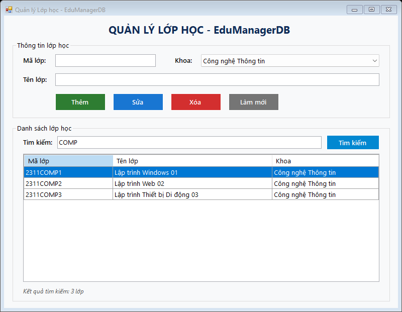

- **Mô tả:**
  - Cho phép tìm kiếm tương đối không phân biệt hoa thường theo cả **Mã lớp** hoặc **Tên lớp**.
  - Hỗ trợ nhấn phím `Enter` trực tiếp ngay trên ô `txtTimKiem` để kích hoạt tìm kiếm nhanh chóng.
  - Sử dụng câu truy vấn tham số hóa kết hợp toán tử `LIKE`:
  ```csharp
  internal void TimKiemLop()
  {
      string tuKhoa = txtTimKiem.Text.Trim();
      using (var conn = new SqlConnection(_connectionString))
      {
          conn.Open();
          string sql = @"SELECT L.MaLop, L.TenLop, K.TenKhoa, L.MaKhoa 
                         FROM LOP L 
                         LEFT JOIN KHOA K ON L.MaKhoa = K.MaKhoa 
                         WHERE L.MaLop LIKE @kw OR L.TenLop LIKE @kw
                         ORDER BY L.MaLop";
          using (var cmd = new SqlCommand(sql, conn))
          {
              cmd.Parameters.AddWithValue("@kw", "%" + tuKhoa + "%");
              using (var da = new SqlDataAdapter(cmd))
              {
                  var dt = new DataTable();
                  da.Fill(dt);
                  dgvLop.DataSource = dt;
                  lblTongSo.Text = $"Kết quả tìm kiếm: {dt.Rows.Count} lớp";
              }
          }
      }
  }
  ```

---

## 8. Kiểm tra tính hợp lệ dữ liệu (Validation & Error Handling)

| Cảnh báo thiếu Mã lớp | Cảnh báo trùng Mã lớp |
| :---: | :---: |
| 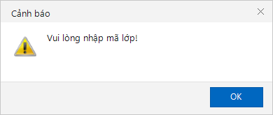 | 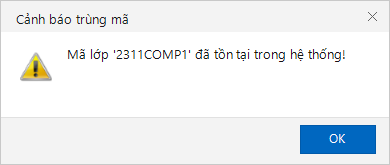 |

- **Quy tắc kiểm tra hợp lệ (`ValidateInput`):**
  - Sử dụng `string.IsNullOrWhiteSpace()` để kiểm tra rỗng hoặc trường hợp người dùng chỉ nhập khoảng trắng.
  - Tự động di chuyển con trỏ chuột (`Focus()`) đến đúng ô nhập liệu chưa hợp lệ.
  - Kiểm tra xem người dùng đã chọn Khoa từ ComboBox hay chưa.
  - Khi thêm mới (`isAdding = true`), thực hiện kiểm tra trùng mã lớp với dữ liệu đã có trong SQL Server.
```csharp
private bool ValidateInput(bool isAdding)
{
    string maLop = txtMaLop.Text.Trim();
    string tenLop = txtTenLop.Text.Trim();

    if (string.IsNullOrWhiteSpace(maLop))
    {
        MessageBox.Show("Vui lòng nhập mã lớp!", "Cảnh báo", MessageBoxButtons.OK, MessageBoxIcon.Warning);
        txtMaLop.Focus();
        return false;
    }
    if (string.IsNullOrWhiteSpace(tenLop))
    {
        MessageBox.Show("Vui lòng nhập tên lớp!", "Cảnh báo", MessageBoxButtons.OK, MessageBoxIcon.Warning);
        txtTenLop.Focus();
        return false;
    }
    if (cboKhoa.SelectedValue == null)
    {
        MessageBox.Show("Vui lòng chọn khoa!", "Cảnh báo", MessageBoxButtons.OK, MessageBoxIcon.Warning);
        cboKhoa.Focus();
        return false;
    }
    if (isAdding && IsMaLopExists(maLop))
    {
        MessageBox.Show($"Mã lớp '{maLop}' đã tồn tại trong hệ thống!", "Cảnh báo trùng mã",
            MessageBoxButtons.OK, MessageBoxIcon.Warning);
        txtMaLop.Focus();
        return false;
    }
    return true;
}
```

---

## 9. Chức năng Làm mới (Reset Form) & An toàn bảo mật SQL

- **Làm mới dữ liệu (`btnLamMoi_Click`):**
  - Xóa trắng nội dung `txtMaLop.Clear()`, `txtTenLop.Clear()`, `txtTimKiem.Clear()`.
  - Mở khóa ô `txtMaLop` (`ReadOnly = false`).
  - Đặt lại lựa chọn của `cboKhoa` về mục đầu tiên (`SelectedIndex = 0`).
  - Tải lại toàn bộ danh sách lớp học và đưa con trỏ chuột về ô `txtMaLop`.
- **An toàn bảo mật — Chống SQL Injection:**
  - Tuyệt đối không ghép chuỗi SQL trực tiếp (`"SELECT ... WHERE MaLop = '" + maLop + "'"`).
  - 100% câu truy vấn tiếp nhận dữ liệu từ người dùng đều sử dụng `SqlParameter`, đảm bảo an toàn và tối ưu hóa Execution Plan trên SQL Server.

---

## 10. Cấu trúc mã nguồn & Bảng phân bố tệp tin

| Tệp tin | Vị trí | Vai trò trong hệ thống |
| :--- | :--- | :--- |
| `FrmLop.cs` | `Lab11/Lab11/` | Chứa toàn bộ logic CRUD ADO.NET, kết nối SQL Server, validation và xử lý sự kiện |
| `FrmLop.Designer.cs` | `Lab11/Lab11/` | Định nghĩa bố cục giao diện WinForms, khai báo và cấu hình các điều khiển |
| `Program.cs` | `Lab11/Lab11/` | Điểm khởi chạy ứng dụng (`Application.Run(new FrmLop())`) và hỗ trợ cờ kiểm thử `--capture` |
| `ScreenshotRunner.cs` | `Lab11/Lab11/` | Module tự động kiểm thử toàn bộ chức năng và chụp ảnh màn hình minh chứng |
| `App.config` | `Lab11/Lab11/` | Tệp cấu hình lưu trữ Connection String chuẩn của ứng dụng |
| `Lab11.csproj` & `Lab11.slnx` | `Lab11/Lab11/` | Cấu hình dự án .NET Framework 4.7.2, tích hợp NuGet `Microsoft.Data.SqlClient` |
| `01_EduManagerDB.sql` | `Lab11/` | Script tạo cơ sở dữ liệu `EduManagerDB`, tạo các bảng `KHOA`, `LOP`, `SINHVIEN` và nạp dữ liệu mẫu |
| `README.md` | `Lab11/` | Báo cáo chi tiết kết quả thực hành Lab 11, hình ảnh minh chứng và hướng dẫn chạy |
| `.gitignore` | `Lab11/` | Loại trừ các tệp tin tạm của Visual Studio (`.vs`, `bin`, `obj`) khi đồng bộ Git |

---

## 11. Hướng dẫn biên dịch và chạy chương trình

### Cách 1: Sử dụng Visual Studio (Khuyên dùng)
1. Mở file giải pháp `Lab11/Lab11/Lab11.slnx` hoặc file dự án `Lab11/Lab11/Lab11.csproj` trong Visual Studio.
2. Nhấn **F5** (hoặc bấm nút **Start**) để tự động restore package, biên dịch và chạy ứng dụng.

### Cách 2: Chạy trực tiếp file thực thi (.exe)
Truy cập thư mục đầu ra của bản dựng:
```
Lab11\Lab11\bin\Debug\Lab11.exe
```
Nhấp đúp chuột để chạy trực tiếp ứng dụng mà không cần mở môi trường lập trình.

### Cách 3: Biên dịch bằng dòng lệnh MSBuild
Mở cửa sổ PowerShell tại thư mục `Lab11/Lab11` và thực hiện các lệnh:
```powershell
& "C:\Program Files\Microsoft Visual Studio\18\Community\MSBuild\Current\Bin\MSBuild.exe" Lab11.csproj /t:Build /p:Configuration=Debug
.\bin\Debug\Lab11.exe
```

### Cách 4: Tự động chạy chuỗi kiểm thử và tạo lại ảnh minh chứng
```powershell
.\bin\Debug\Lab11.exe --capture
```
Lệnh này sẽ tự động chạy qua toàn bộ các luồng nghiệp vụ (F1 đến F8, validation, thông báo và bắt lỗi khóa ngoại), đồng thời xuất toàn bộ các ảnh chụp màn hình cập nhật mới nhất vào thư mục `Lab11/screenshots/`.
