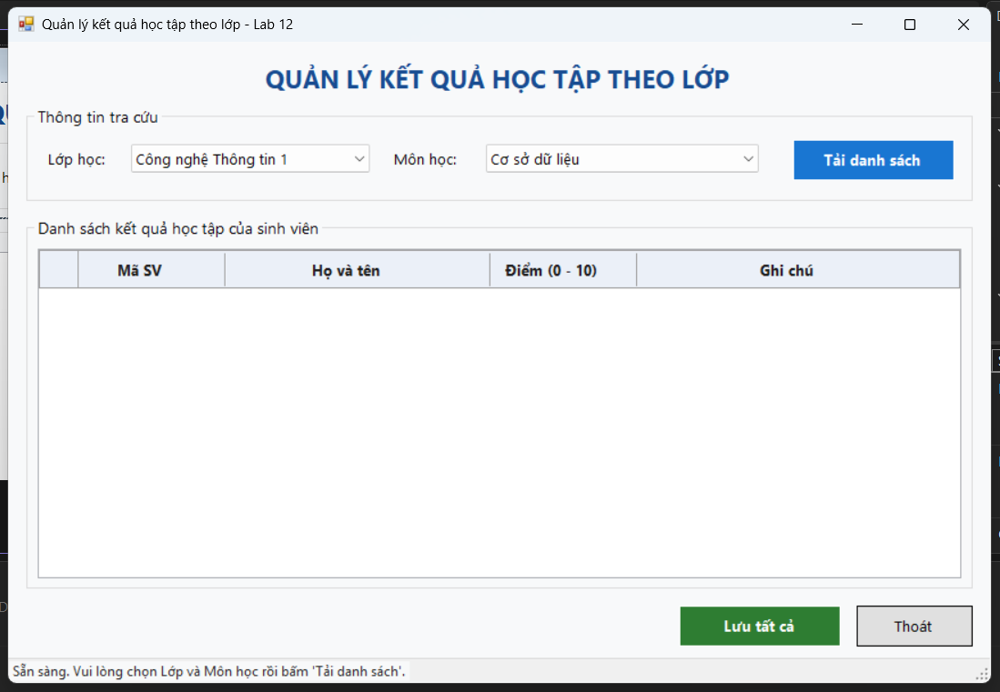
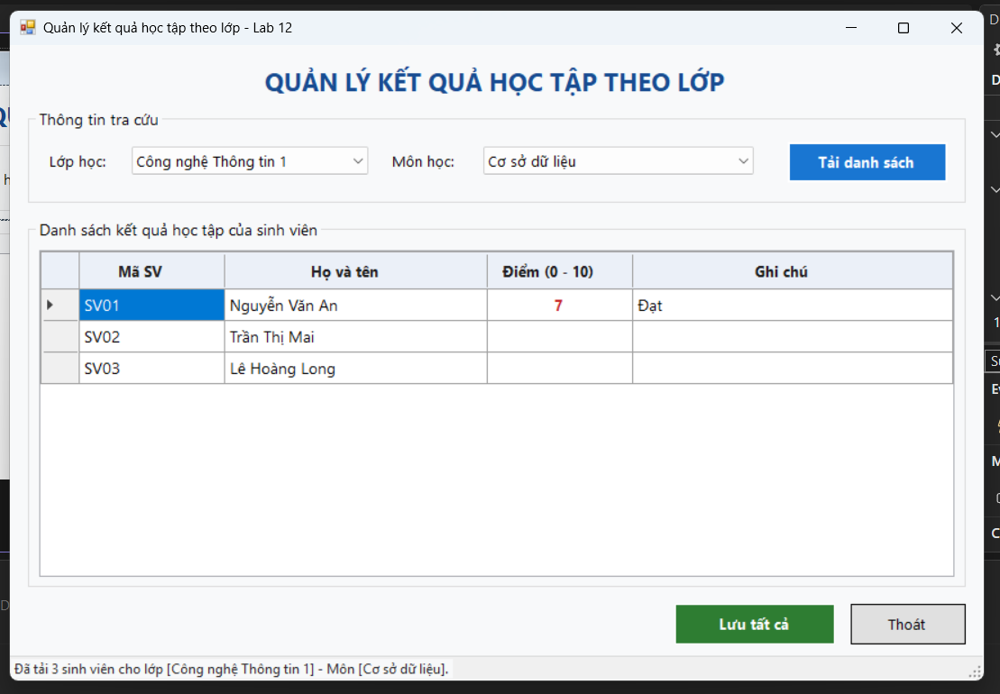
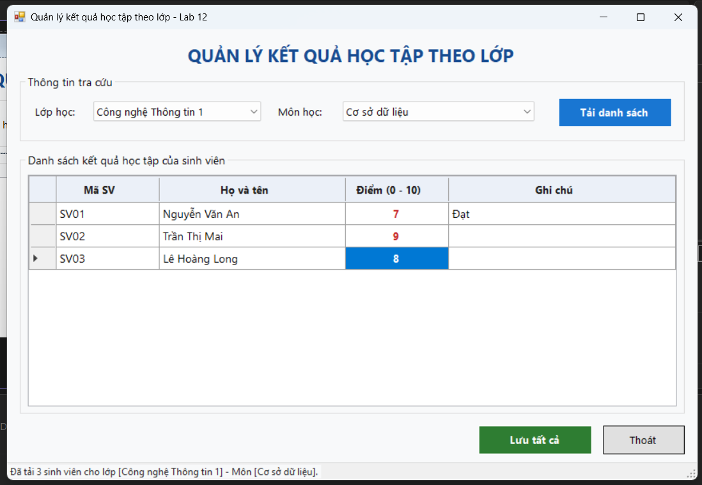
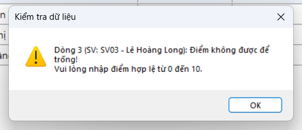
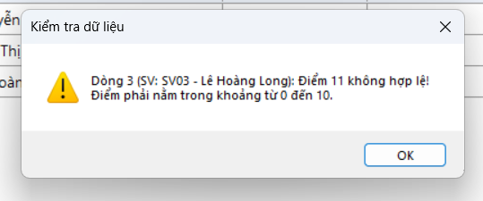
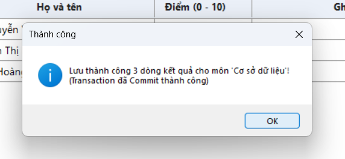
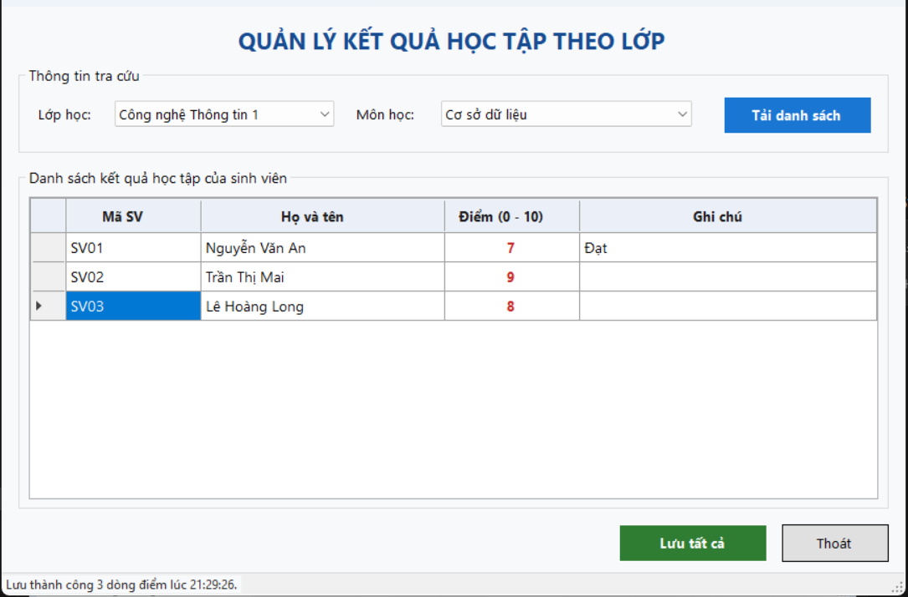
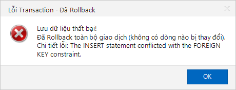

# BÁO CÁO KẾT QUẢ THỰC HÀNH LAB 12
**Học phần:** COMP1019 - Lập trình trên Windows  
**Đề tài:** Bài Lab 12 - Data Binding, Stored Procedure và Transaction (Quản lý kết quả học tập)  
**Giảng viên:** ThS. Lê Thanh Thoại  
**Sinh viên thực hiện:** Đặng Hoàng Bảo Huy | **MSSV:** 51.01.104.033 | **Lớp:** 51.01.CNTT.C  

---

## 1. Tổng quan & Môi trường thực thi

### Bảng thông tin môi trường

| Mục | Chi tiết cấu hình |
| :--- | :--- |
| **Hệ điều hành** | Windows 11 Home Single Language 64-bit |
| **Công cụ phát triển** | Visual Studio Community, MSBuild 18.x |
| **Nền tảng mục tiêu** | .NET Framework 4.7.2 (Windows Forms App) |
| **Hệ quản trị CSDL** | Microsoft SQL Server 2025 Developer (`localhost`) |
| **Thư viện ADO.NET** | **`Microsoft.Data.SqlClient` (v5.2.2)** qua NuGet PackageReference |
| **Cơ sở dữ liệu** | `QLSinhVienLab12` (Bảng `LOP`, `SINHVIEN`, `MONHOC`, `KETQUA`) |
| **Mã nguồn dự án** | [`Lab12/Lab12/`](Lab12/) |
| **Script CSDL & SPs** | [`01_QLSinhVienLab12.sql`](01_QLSinhVienLab12.sql) |

### Cấu hình chuỗi kết nối (`App.config`)
Chuỗi kết nối được thiết lập trong file [`Lab12/App.config`](Lab12/App.config):
```xml
<configuration>
    <connectionStrings>
        <add name="QLSinhVienLab12" 
             connectionString="Server=localhost;Database=QLSinhVienLab12;Integrated Security=True;TrustServerCertificate=True;" 
             providerName="Microsoft.Data.SqlClient" />
    </connectionStrings>
</configuration>
```
Lớp [`Lab12.DAL.Database`](Lab12/DAL/Database.cs) đọc chuỗi kết nối an toàn từ `ConfigurationManager` và cung cấp kết nối `SqlConnection`.

---

## 2. Thiết kế Cơ sở Dữ liệu & Stored Procedures

### 2.1 Cấu trúc các bảng
- **`LOP`**: `MaLop VARCHAR(10) PRIMARY KEY`, `TenLop NVARCHAR(100) NOT NULL`.
- **`SINHVIEN`**: `MaSV VARCHAR(10) PRIMARY KEY`, `HoTen NVARCHAR(100) NOT NULL`, `NgaySinh DATE`, `MaLop VARCHAR(10) FOREIGN KEY REFERENCES LOP(MaLop)`.
- **`MONHOC`**: `MaMon VARCHAR(10) PRIMARY KEY`, `TenMon NVARCHAR(100) NOT NULL`, `SoTinChi INT NOT NULL DEFAULT 3`.
- **`KETQUA`**: Khóa chính kết hợp `(MaSV, MaMon)`, khóa ngoại tham chiếu `SINHVIEN(MaSV)` và `MONHOC(MaMon)`. Ràng buộc `CHECK (Diem IS NULL OR (Diem >= 0 AND Diem <= 10))`.

### 2.2 4 Stored Procedures bắt buộc
1. **`sp_Lop_GetAll`**: Lấy danh sách toàn bộ lớp học để bind vào `cboLop`.
2. **`sp_MonHoc_GetAll`**: Lấy danh sách toàn bộ môn học để bind vào `cboMonHoc`.
3. **`sp_KetQua_GetByLopMon`**: Dùng `LEFT JOIN` giữa `SINHVIEN` và `KETQUA` theo `@MaMon` và `@MaLop` để lấy toàn bộ sinh viên trong lớp (kể cả sinh viên chưa có điểm):
   ```sql
   SELECT sv.MaSV, sv.HoTen, kq.Diem, kq.GhiChu
   FROM SINHVIEN sv
   LEFT JOIN KETQUA kq ON sv.MaSV = kq.MaSV AND kq.MaMon = @MaMon
   WHERE sv.MaLop = @MaLop
   ORDER BY sv.MaSV;
   ```
4. **`sp_KetQua_Save`**: Kiểm tra sinh viên đã có điểm môn học thì `UPDATE`, nếu chưa có thì `INSERT`:
   ```sql
   IF EXISTS (SELECT 1 FROM KETQUA WHERE MaSV = @MaSV AND MaMon = @MaMon)
       UPDATE KETQUA SET Diem = @Diem, GhiChu = @GhiChu WHERE MaSV = @MaSV AND MaMon = @MaMon;
   ELSE
       INSERT INTO KETQUA (MaSV, MaMon, Diem, GhiChu) VALUES (@MaSV, @MaMon, @Diem, @GhiChu);
   ```

---

## 3. Kiến trúc Code & Data Access Layer (DAL)

Dự án tách biệt hoàn toàn giữa tầng giao diện người dùng và tầng dữ liệu:
- **`DAL/Database.cs`**: Quản lý chuỗi kết nối và tạo kết nối đến CSDL.
- **`DAL/KetQuaDAL.cs`**: Chứa các phương thức xử lý nghiệp vụ truy xuất CSDL:
  - `DataTable GetDanhSachLop()`
  - `DataTable GetDanhSachMonHoc()`
  - `DataTable GetKetQuaTheoLopMon(string maLop, string maMon)`
  - `bool LuuTatCaKetQua(string maMon, DataTable dtKetQua, out int soDongLuu, out string thongBaoLoi)`: Thực hiện bằng `SqlTransaction`.

### Cơ chế Transaction trong `KetQuaDAL.cs`:
```csharp
using (var conn = Database.GetConnection())
{
    conn.Open();
    using (var trans = conn.BeginTransaction())
    {
        try
        {
            foreach (DataRow row in dtKetQua.Rows)
            {
                // Gọi sp_KetQua_Save với tham số an toàn và cmd.Transaction = trans
                using (var cmd = new SqlCommand("sp_KetQua_Save", conn, trans))
                {
                    cmd.CommandType = CommandType.StoredProcedure;
                    cmd.Parameters.Add("@MaSV", SqlDbType.VarChar, 10).Value = row["MaSV"];
                    cmd.Parameters.Add("@MaMon", SqlDbType.VarChar, 10).Value = maMon;
                    cmd.Parameters.Add("@Diem", SqlDbType.Float).Value = Convert.ToDouble(row["Diem"]);
                    cmd.Parameters.Add("@GhiChu", SqlDbType.NVarChar, 255).Value = row["GhiChu"] ?? DBNull.Value;
                    cmd.ExecuteNonQuery();
                }
                soDongLuu++;
            }
            trans.Commit(); // Cam kết toàn bộ thay đổi khi tất cả dòng thành công
            return true;
        }
        catch (Exception ex)
        {
            trans.Rollback(); // Hủy bỏ toàn bộ thao tác nếu có bất kỳ dòng nào lỗi
            soDongLuu = 0;
            thongBaoLoi = ex.Message;
            return false;
        }
    }
}
```

---

## 4. Giao diện & Minh chứng Chức năng (Screenshots)

### 4.1 Khởi tạo Form & Data Binding vào ComboBox
Khi mở form, ứng dụng gọi Stored Procedures và bind dữ liệu danh sách lớp vào `cboLop` (`ValueMember="MaLop"`, `DisplayMember="TenLop"`) và môn học vào `cboMonHoc` (`ValueMember="MaMon"`, `DisplayMember="TenMon"`).



---

### 4.2 Tải danh sách sinh viên lên DataGridView
Người dùng chọn Lớp học (VD: `23CNTT1`), chọn Môn học (VD: `Lập trình trên Windows`) và bấm nút **Tải danh sách**. Dữ liệu được đưa qua `BindingSource` và hiển thị trên `dgvKetQua`:



---

### 4.3 Nhập/sửa Điểm và Ghi chú cho sinh viên
Các cột `MaSV` và `HoTen` ở chế độ `ReadOnly`, người dùng trực tiếp nhập/sửa trên cột `Diem` và `GhiChu`:



---

### 4.4 Kiểm tra hợp lệ dữ liệu (Validation)

#### Kịch bản 1: Để trống ô điểm
Nếu người dùng để trống ô điểm, hệ thống phát hiện lỗi ngay tại dòng tương ứng, đưa con trỏ focus vào ô lỗi và thông báo không cho phép lưu:



#### Kịch bản 2: Điểm ngoài khoảng $[0, 10]$ hoặc không phải số
Nếu người dùng nhập điểm âm hoặc lớn hơn 10 (ví dụ `11.5`), hệ thống thông báo lỗi vi phạm thang điểm:



---

### 4.5 Lưu nhiều dòng bằng Transaction & Commit thành công
Sau khi tất cả các dòng dữ liệu điểm đều hợp lệ, người dùng bấm **Lưu tất cả**. Hệ thống mở `SqlTransaction`, duyệt qua từng dòng gọi `sp_KetQua_Save` và thực hiện `trans.Commit()`:



Form cập nhật trạng thái đã lưu trên thanh `StatusStrip` và nạp lại danh sách điểm đã đồng bộ:



---

### 4.6 Rollback an toàn khi xảy ra lỗi Transaction
Khi có sự cố ngoại lệ ở bất kỳ dòng dữ liệu nào trong quá trình thực thi, lệnh `trans.Rollback()` sẽ được gọi ngay lập tức, đảm bảo tính toàn vẹn dữ liệu (không có dòng nào bị lưu dở dang):



---

## 5. Hướng dẫn Chạy Ứng dụng

1. **Khởi tạo Cơ sở dữ liệu SQL Server:**
   ```powershell
   sqlcmd -S localhost -E -C -i "01_QLSinhVienLab12.sql"
   ```
2. **Mở dự án:**
   Mở file [`Lab12/Lab12/Lab12.slnx`](Lab12/Lab12.slnx) bằng **Visual Studio**.
3. **Biên dịch và Chạy:**
   - Nhấn **F5** để khởi chạy ứng dụng trực quan.
   - Hoặc chạy lệnh tự động tạo lại ảnh minh chứng:
     ```powershell
     & "Lab12\Lab12\bin\Debug\Lab12.exe" --capture
     ```
