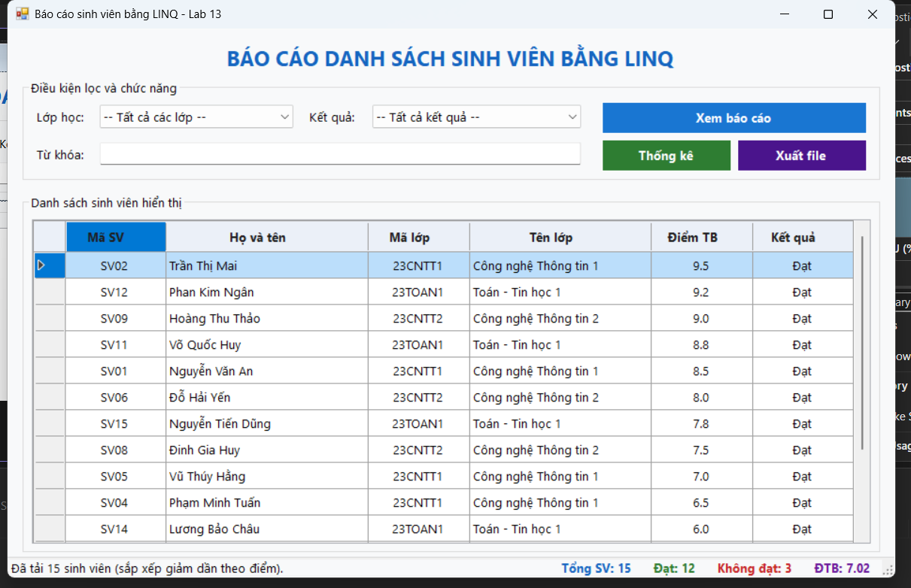
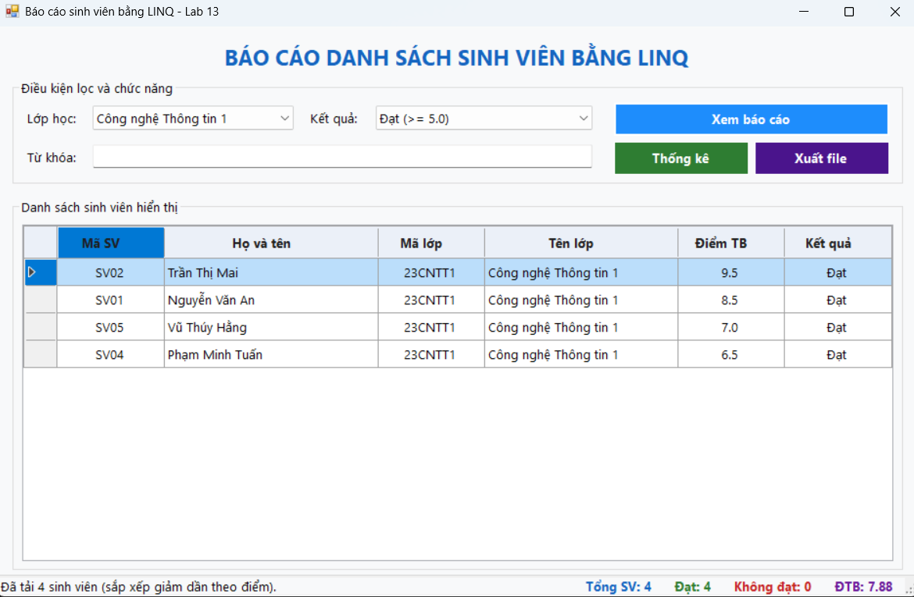
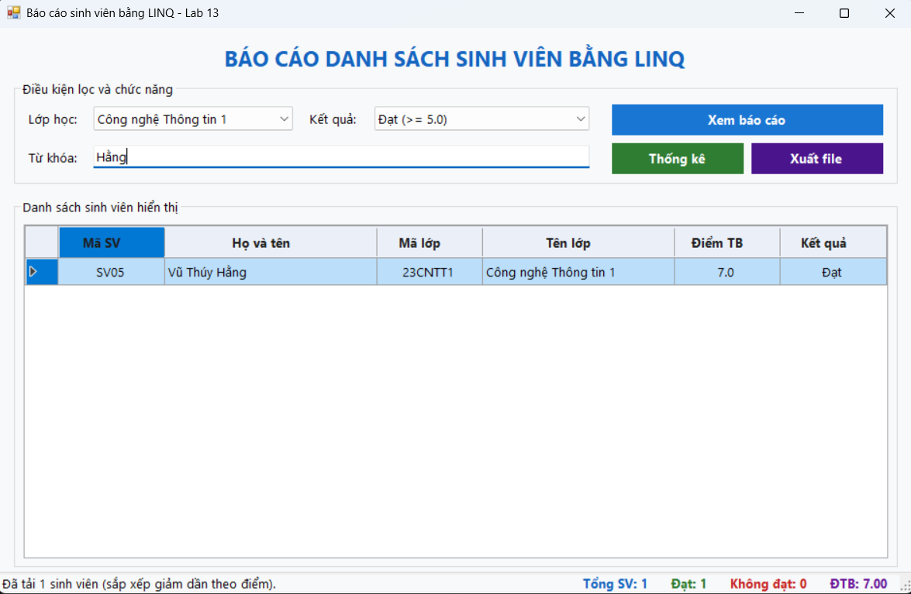
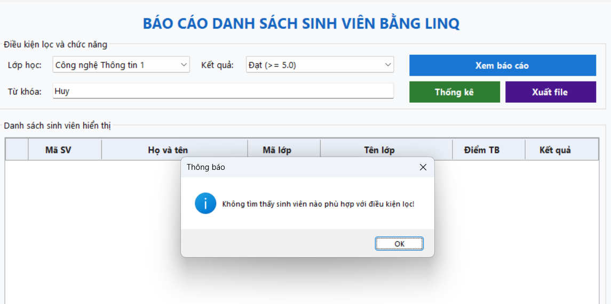
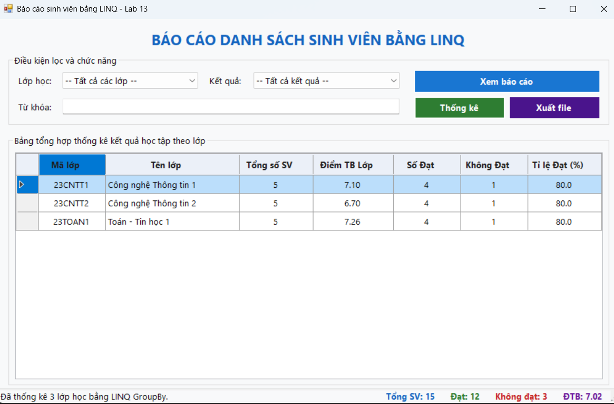
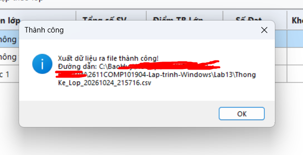

# BÁO CÁO KẾT QUẢ THỰC HÀNH LAB 13
**Học phần:** COMP1019 - Lập trình trên Windows  
**Đề tài:** Bài Lab 13 - Báo cáo sinh viên bằng LINQ (C# WinForms)  
**Giảng viên:** ThS. Lê Thanh Thoại  
**Sinh viên thực hiện:** Đặng Hoàng Bảo Huy | **MSSV:** 51.01.104.033 | **Lớp:** 51.01.CNTT.C  

---

## 1. Tổng quan & Môi trường thực thi

### Bảng thông tin môi trường

| Mục | Chi tiết cấu hình |
| :--- | :--- |
| **Hệ điều hành** | Windows 11 Home Single Language 64-bit |
| **Công cụ phát triển** | Visual Studio Community, MSBuild 18.x |
| **Nền tảng mục tiêu** | .NET Framework 4.7.2 (Windows Forms App) |
| **Công nghệ áp dụng** | C# WinForms, LINQ to Objects, DataGridView, SaveFileDialog |
| **Mã nguồn dự án** | [`Lab13/Lab13/`](Lab13/) (Solution: `Lab13.slnx`, Project: `Lab13.csproj`) |
| **File báo cáo xuất ra** | [`BaoCao_SinhVien.csv`](BaoCao_SinhVien.csv), [`BaoCao_SinhVien.txt`](BaoCao_SinhVien.txt) & [`ThongKe_Lop_20261024_215716.csv`](ThongKe_Lop_20261024_215716.csv) |

---

## 2. Thiết kế Mô hình Dữ liệu (Models) & Dữ liệu mẫu

### 2.1 Model `SinhVien` ([`Models/SinhVien.cs`](Lab13/Models/SinhVien.cs))
Lớp đối tượng sinh viên gồm các thuộc tính lưu trữ thông tin cơ bản và thuộc tính chỉ đọc `KetQua`:
```csharp
public class SinhVien
{
    public string MaSV { get; set; }
    public string HoTen { get; set; }
    public string MaLop { get; set; }
    public string TenLop { get; set; }
    public double Diem { get; set; }

    // Thuộc tính chỉ đọc tự động tính toán kết quả theo thang điểm 5.0
    public string KetQua => Diem >= 5.0 ? "Đạt" : "Không đạt";
}
```

### 2.2 Model `ThongKeLop` ([`Models/ThongKeLop.cs`](Lab13/Models/ThongKeLop.cs))
Lớp đối tượng phục vụ tổng hợp dữ liệu gom nhóm theo lớp học:
```csharp
public class ThongKeLop
{
    public string MaLop { get; set; }
    public string TenLop { get; set; }
    public int TongSoSV { get; set; }
    public double DiemTrungBinh { get; set; }
    public int SoLuongDat { get; set; }
    public int SoLuongKhongDat { get; set; }
    public double TiLeDat => TongSoSV > 0 ? Math.Round((double)SoLuongDat / TongSoSV * 100, 1) : 0;
}
```

### 2.3 Khởi tạo dữ liệu mẫu (`TaoDuLieuMau`)
Chương trình khởi tạo sẵn danh sách 15 sinh viên (vượt mức tối thiểu 12 SV theo yêu cầu) phân bổ trên 3 lớp học:
- **`23CNTT1` (Công nghệ Thông tin 1):** 5 sinh viên (Điểm: 8.5, 9.5, 4.0, 6.5, 7.0).
- **`23CNTT2` (Công nghệ Thông tin 2):** 5 sinh viên (Điểm: 8.0, 3.5, 7.5, 9.0, 5.5).
- **`23TOAN1` (Toán - Tin học 1):** 5 sinh viên (Điểm: 8.8, 9.2, 4.5, 6.0, 7.8).

---

## 3. Ứng dụng Toàn diện Kỹ thuật LINQ

Toàn bộ thao tác nghiệp vụ trong bài thực hành đều được triển khai bằng cú pháp **LINQ to Objects**:

### 3.1 Lọc dữ liệu kết hợp nhiều điều kiện (`XemBaoCao`)
```csharp
var query = _danhSachSinhVien.AsEnumerable();

// 1. Lọc theo lớp học
if (cboLop.SelectedIndex > 0 && cboLop.SelectedValue != null)
{
    string maLopChon = cboLop.SelectedValue.ToString();
    query = query.Where(sv => sv.MaLop == maLopChon);
}

// 2. Lọc theo kết quả học tập (Đạt >= 5.0, Không đạt < 5.0)
if (cboKetQua.SelectedIndex == 1) // Đạt
    query = query.Where(sv => sv.Diem >= 5.0);
else if (cboKetQua.SelectedIndex == 2) // Không đạt
    query = query.Where(sv => sv.Diem < 5.0);

// 3. Lọc theo từ khóa tìm kiếm (Mã sinh viên hoặc Họ tên)
string tuKhoa = txtTuKhoa.Text.Trim().ToLower();
if (!string.IsNullOrEmpty(tuKhoa))
{
    query = query.Where(sv => sv.MaSV.ToLower().Contains(tuKhoa) || 
                              sv.HoTen.ToLower().Contains(tuKhoa));
}
```

### 3.2 Sắp xếp giảm dần theo điểm (`OrderByDescending`)
```csharp
// Sắp xếp giảm dần theo Điểm trung bình bằng LINQ
_danhSachHienTai = query.OrderByDescending(sv => sv.Diem).ToList();
```

### 3.3 Thống kê tổng hợp số liệu (`CapNhatThongKe`)
```csharp
int tongSV = danhSach.Count;
int soDat = danhSach.Count(sv => sv.Diem >= 5.0);
int soKhongDat = tongSV - soDat;
double dtb = tongSV > 0 ? Math.Round(danhSach.Average(sv => sv.Diem), 2) : 0.0;

lblTongSV.Text = $"Tổng SV: {tongSV}";
lblSoDat.Text = $"Đạt: {soDat}";
lblSoKhongDat.Text = $"Không đạt: {soKhongDat}";
lblDiemTB.Text = $"ĐTB: {dtb:0.00}";
```

### 3.4 Gom nhóm & Thống kê theo Lớp học (`ThongKeTheoLop`)
```csharp
var thongKe = _danhSachSinhVien
    .GroupBy(sv => new { sv.MaLop, sv.TenLop })
    .Select(g => new ThongKeLop
    {
        MaLop = g.Key.MaLop,
        TenLop = g.Key.TenLop,
        TongSoSV = g.Count(),
        DiemTrungBinh = Math.Round(g.Average(sv => sv.Diem), 2),
        SoLuongDat = g.Count(sv => sv.Diem >= 5.0),
        SoLuongKhongDat = g.Count(sv => sv.Diem < 5.0)
    })
    .OrderBy(tk => tk.MaLop)
    .ToList();
```

---

## 4. Chức năng Xuất file Báo cáo (CSV & TXT)

Hệ thống tích hợp `SaveFileDialog` hỗ trợ xuất báo cáo theo 2 định dạng:
1. **Định dạng CSV (`*.csv`):**
   - Sử dụng bảng mã **UTF-8 kèm BOM** (`new UTF8Encoding(true)`): Đảm bảo khi mở file CSV bằng Microsoft Excel không bao giờ bị lỗi font tiếng Việt.
   - Các trường dữ liệu được bao bởi dấu ngoặc kép an toàn.
2. **Định dạng Text (`*.txt`):**
   - Thiết kế dạng bảng biểu báo cáo căn cột thẳng hàng, hiển thị rõ ràng thông tin sinh viên, điểm số và dòng tổng kết thống kê.
3. **Xử lý ngoại lệ (`try-catch`):** Bắt và thông báo chi tiết lỗi nếu file đang mở bởi ứng dụng khác hoặc không có quyền ghi.

---

## 5. Minh chứng Chức năng & Giao diện (Screenshots)

### 5.1 Khởi tạo Form & Hiển thị Toàn bộ Danh sách
Khi khởi động ứng dụng, toàn bộ 15 sinh viên được hiển thị trên `dgvBaoCao`, sắp xếp giảm dần theo điểm. ComboBox Lớp học và Kết quả được nạp tự động:



---

### 5.2 Lọc theo Lớp & Kết quả học tập
Người dùng chọn lớp (VD: `23CNTT1`) và chọn kết quả `Đạt (>= 5.0)`, bấm **Xem báo cáo**:
- DataGridView chỉ hiển thị các sinh viên đạt yêu cầu của lớp đó.
- Thanh StatusStrip cập nhật chính xác số lượng và điểm trung bình tương ứng.



---

### 5.3 Tìm kiếm theo Từ khóa
Người dùng nhập tên sinh viên hoặc mã sinh viên vào ô `txtTuKhoa` (hỗ trợ nhấn Enter để tìm nhanh):
- Hệ thống lọc tức thì danh sách sinh viên phù hợp bằng LINQ.



---

### 5.4 Thông báo khi không tìm thấy dữ liệu
Khi người dùng nhập điều kiện lọc không tồn tại:
- Hệ thống hiển thị hộp thoại `MessageBox` thông báo rõ ràng: *"Không tìm thấy sinh viên nào phù hợp với điều kiện lọc!"*.



---

### 5.5 Bảng Thống kê Gom nhóm theo Lớp học
Bấm nút **Thống kê**:
- Giao diện chuyển sang hiển thị bảng tổng hợp kết quả từng lớp bằng LINQ `GroupBy`: Mã lớp, Tên lớp, Tổng SV, Điểm trung bình lớp, Số Đạt, Số Không đạt và Tỉ lệ Đạt (%).



---

### 5.6 Hộp thoại Xuất file & Thông báo thành công
Bấm nút **Xuất file**:
- Hiển thị hộp thoại `SaveFileDialog` cho phép chọn đuôi `.csv` hoặc `.txt`.
- Xuất thành công hiển thị thông báo kèm đường dẫn file lưu.



---
## 6. Hướng dẫn Chạy Ứng dụng

1. Mở file solution [`Lab13/Lab13/Lab13.slnx`](Lab13/Lab13/Lab13.slnx) bằng **Visual Studio**.
2. Nhấn **F5** (hoặc Ctrl + F5) để khởi chạy ứng dụng.
3. Thử nghiệm các thao tác:
   - Chọn Lớp học hoặc chọn Kết quả $\rightarrow$ Bấm **Xem báo cáo**.
   - Nhập từ khóa tên sinh viên $\rightarrow$ Nhấn Enter.
   - Bấm **Thống kê** để xem bảng tổng hợp lớp học.
   - Bấm **Xuất file** để lưu kết quả báo cáo ra máy tính.
